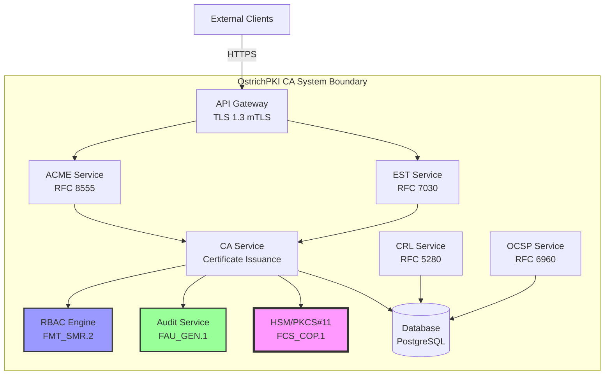

# Authority to Operate (ATO) Evidence Collection Guide

**Document Version:** 1.10
**Generated:** 2026-01-04 (revised 2026-10-26)
**OstrichPKI Version:** 0.15.0
**Framework:** NIST Risk Management Framework (RMF)
**Compliance Standards:** NIST 800-53 Rev 5, NIAP PP-CA v2.1, FIPS 140-2/140-3

---

## Multi-Agent Development Workflow (CM-3 / SA-11 / CA-2)

Changes can be run through the `/ostrich-workflow` skill, which coordinates
specialist Claude Code subagents: architect, coder, QA engineer, security
reviewer, NIST 800-53 Rev 5 / NIAP reviewer, PQC/FIPS crypto reviewer, RFC
conformance reviewer, compliance scribe, and release engineer. Reviewers are
read-only and work independently; must-fix findings loop back to the coder and
are re-verified by the reviewer that raised them.

| Control | Framework   | Evidence |
|---------|-------------|----------|
| CM-3    | NIST 800-53 | Per-change record in `target/agent-workflow/<run>/`: `plan.md`, `findings-*.md`, `fixes-round-*.md`, `gate.md` (PASS / PASS WITH POA&M / FAIL) |
| SA-11   | NIST 800-53 | `qa-report.md` lists every gate command with result; gates not run are recorded as NOT RUN ([quality-gates.md](../../.claude/skills/ostrich-workflow/references/quality-gates.md)) |
| CA-2    | NIST 800-53 | Independent security, control, crypto, and protocol reviews per [triage-matrix.md](../../.claude/skills/ostrich-workflow/references/triage-matrix.md) |

Run records live under the gitignored `target/` directory. To keep one as ATO
evidence, copy it into the evidence store described in §5. The workflow is a
developer-side aid; it does not replace human change approval (see the CM-3
gap in `NIST_800-53_MAPPING.md`).

Definitions: [.claude/skills/ostrich-workflow/SKILL.md](../../.claude/skills/ostrich-workflow/SKILL.md),
[.claude/agents/](../../.claude/agents/).

---

## NPE Portal → CA Identity Bridge over mTLS (AC-17 / SC-8 / IA-2 / AC-3)

The NPE portal forwards each operator's identity to the CA as `X-Npe-*` headers.
This is only trustworthy over a mutually-authenticated channel: the portal
presents a client certificate the CA can verify, and the CA honours the
forwarded identity only from that allow-listed proxy subject. Wired and verified
in the live cluster 2026-07-02.

| Control / SFR | Framework   | Evidence |
|---------------|-------------|----------|
| AC-17         | NIST 800-53 | ca-server REST serves TLS 1.3 with optional client auth (`TLS_CERT_FILE`/`TLS_KEY_FILE`/`TLS_CLIENT_CA_FILE`); `CA_TRUSTED_PROXY_SUBJECTS=CN=npe-portal`. Startup log: "Identity bridge enabled … subjects=[CN=npe-portal]", "Serving HTTPS (TLS 1.3) … mtls=true". |
| SC-8          | NIST 800-53 | The forwarded identity travels over mTLS, not plaintext HTTP. Portal dials `https://ca-service:8080` presenting its client cert (`backend_client.rs` → "Backend proxy: mTLS enabled"). |
| IA-2 / AC-3   | NIST 800-53 | `TrustedProxyAuthLayer` accepts `X-Npe-*` only when the peer cert subject is allow-listed; the CA then enforces RBAC on the bridged NPE role. `is_bridgeable_role` caps bridged roles to NPE roles (AC-6). |
| FTP_ITC.1     | NIAP PP-CA  | Inter-service trusted channel between portal and CA is mutually authenticated (both present certificates issued by the OstrichPKI Intermediate CA). |

Live verification (replaying the portal's exact request to the CA):

```
client cert (CN=npe-portal) + X-Npe-Roles: caa_admin   → HTTP 200  (namespaces)
no client cert (spoofed header only)                   → HTTP 401  (bridge refuses)
client cert + X-Npe-Roles: pki_sponsor                 → HTTP 403  (lacks ManageNamespaces)
```

Certificates are issued from the running OstrichPKI Intermediate CA (dogfood),
not a standalone CA. Full reproduction (issuance, secrets, deployment, probes) is
documented in [docs/runbooks/npe-portal-ca-mtls-bridge.md](../runbooks/npe-portal-ca-mtls-bridge.md).

Code path summary:

- [services/ca-server/src/main.rs](../../services/ca-server/src/main.rs) — TLS + `CA_TRUSTED_PROXY_SUBJECTS`, `with_optional_client_auth`
- [crates/ostrich-common/src/auth/middleware.rs](../../crates/ostrich-common/src/auth/middleware.rs) — `TrustedProxyAuthLayer`, `is_bridgeable_role`, `build_trusted_proxy_user`
- [services/npe-portal/src/server/backend_client.rs](../../services/npe-portal/src/server/backend_client.rs) — portal presents client cert to backends
- [services/npe-portal/src/server/proxy.rs](../../services/npe-portal/src/server/proxy.rs) — strips inbound `X-Npe-*` (anti-spoofing) and re-attaches the authenticated identity

Note: the ca-server overlay (`deploy/cluster/ostrich-test-ca.yaml`) and the
`ca-mtls` / `npe-backend-mtls` secrets are cluster-local (gitignored / not in
source control); the runbook is the source of truth for re-provisioning them.

---

## Phase 1c Gap-Closure Evidence (SCMS Schema + Repository)

The data layer for SCMS now matches the service-model surface. Migration
[00005_scms_token_fields.sql](../../migrations/00005_scms_token_fields.sql)
moves source-of-truth for nine fields out of in-memory defaults and into the
database. Hardware-backed PKCS#11 calls (`C_Login`, on-token `C_GenerateKeyPair`,
`C_DestroyObject`) remain a Phase 1c-hardware follow-up; the data path,
audit trail, and lifecycle state machine are complete.

| Control / SFR | Framework  | Evidence |
|---------------|------------|----------|
| FIA_AFL.1     | NIAP PP-CA  | `tokens.so_pin_attempts_remaining` is a distinct counter from `pin_attempts_remaining`, persisted via migration 00005. `unblock_token` resets both. `verify_pin` flips status to `blocked` atomically with the User-PIN counter hitting zero. |
| FMT_SMR.1     | NIAP PP-CA  | SO PIN and User PIN counters tracked independently in `tokens` table; SO PIN updates go through `ScmsRepository::update_token_so_pin_attempts`. |
| FMT_SMF.1     | NIAP PP-CA  | Lifecycle timestamps (`initialized_at`, `expires_at`) recorded by `update_token_lifecycle`; `initialize_token` handler now writes the timestamp on transition. |
| FCS_COP.1     | NIAP PP-CA  | `token_keys.usage` array stores X.509 KeyUsage flags (RFC 5280 §4.2.1.3) per key; `token_keys.key_size` recorded for queryable strength. |
| FPT_STM.1     | NIAP PP-CA  | All lifecycle timestamps (`initialized_at`, `expires_at`, `assigned_at`, `blocked_at`, `retired_at`) come from `Utc::now()` at the repository layer, not client input. |
| CM-3          | NIST 800-53 | Migration is forward-only, checked-in (`migrations/00005_scms_token_fields.sql`), and includes inline comments explaining each column's compliance role. |

Test evidence:

```
cargo check --workspace                          # Clean
cargo test -p ostrich-db -p ostrich-scms --lib   # 50 + 15 passed
cargo test -p ostrich-common --lib               # 145 passed (no regressions)
```

Code path summary:

- [migrations/00005_scms_token_fields.sql](../../migrations/00005_scms_token_fields.sql) — adds 9 columns
- [crates/ostrich-db/src/models/scms.rs](../../crates/ostrich-db/src/models/scms.rs) — Token / TokenModel / TokenKey carry new fields
- [crates/ostrich-db/src/repository/scms.rs](../../crates/ostrich-db/src/repository/scms.rs) — `create_token` accepts label; new `update_token_lifecycle`, `update_token_so_pin_attempts`, `update_token_label` methods; `create_token_model` and `create_token_key` accept the full field set
- [crates/ostrich-scms/src/rest.rs](../../crates/ostrich-scms/src/rest.rs) — `list_tokens` accepts `status` / `assignedTo` / `page` / `limit` query parameters; `initialize_token` records `initialized_at`; `unblock_token` resets the SO-PIN counter; `map_db_token_to_service` reads real DB columns instead of hard-coded defaults

Phase 1c-hardware (next iteration):

- Extend `CryptoProvider` with PIN-management ops (`verify_user_pin`, `set_user_pin`, `verify_so_pin`, `unblock_user_pin`)
- Wire `cryptoki::Session::login(CKU_USER)` and `set_pin` calls in a new `Pkcs11ScmsAdapter`
- On-token keygen: `C_GenerateKeyPair` with `CKA_TOKEN=true` against softhsm2
- Integration test driving init → personalize → fail-PIN-3x → lockout → unblock against softhsm2 (test harness already exists at `tests/setup_softhsm.sh`)

---

## Audit Trail Tamper-Evidence Evidence (AU-9(3) / AU-10)

The audit hash chain was made genuinely verifiable and a signing layer was added
so the trail is tamper-evident even against an attacker with database write
access (the SHA-256 chain alone is not — such an attacker can recompute it).

| Control / SFR | Framework  | Evidence |
|---------------|------------|----------|
| AU-9(3)       | NIST 800-53 | `DatabaseAuditSink::record()` links `previous_hash` and truncates the timestamp to microseconds before hashing; `AuditRepository::verify_chain()` recomputes every hash and checks continuity. Both integrity bugs that made the DB chain unverifiable (nanosecond timestamp, missing chain link) are fixed. |
| AU-10         | NIST 800-53 | `DatabaseAuditSink::with_signing_key()` signs each `event_hash`; `verify_signed_chain(spki, algorithm)` verifies the chain AND every signature. `signature` / `signing_key_id` columns added in `migrations/00007_audit_signature.sql`. |
| FAU_STG.4     | NIAP PP-CA  | Signed records: a modified record's signature no longer verifies and cannot be re-signed without the key — undetected modification is prevented even after a full hash-chain rewrite. |

Test evidence (live, against a real Postgres):

```
DATABASE_URL=... cargo test -p ostrich-audit --test signed_chain_tamper
# 1 test passed — signature_catches_tamper_that_hash_chain_misses:
#  1. writes 3 signed audit records to Postgres
#  2. verify_integrity (hash chain) AND verify_signed_chain both pass
#  3. forges the LAST record's actor and recomputes its event_hash
#     -> verify_integrity is FOOLED (returns true) — the gap AU-10 closes
#     -> verify_signed_chain DETECTS it (stale signature fails over forged hash)
```

Production wiring (live, against a real Postgres + SoftHSM PKCS#11 HSM):

```
SOFTHSM2_CONF=... DATABASE_URL=... PKCS11_MODULE_PATH=... PKCS11_SLOT=... \
  PKCS11_PIN=... cargo test -p ostrich-ca --lib audit_signing_e2e
# ca_emits_signed_audit_records_verifiable_with_ca_public_key:
#  1. builds a CertificateAuthority backed by a SoftHSM (PKCS#11) ECDSA CA key
#  2. performs a real revocation through the CA
#  3. asserts the audit record is signed (signature non-null,
#     signing_key_id = CA key) and verify_signed_chain accepts it against the
#     CA certificate's public key
#  4. corrupts a signature byte -> verify_signed_chain rejects it
```

`CertificateAuthority::new` ([crates/ostrich-ca/src/ca.rs](crates/ostrich-ca/src/ca.rs))
constructs signed sinks for both the issuer and the revocation manager, signing
each audit record's `event_hash` with the HSM-backed CA key. An HSM (PKCS#11)
key is required for the live test because software ECDSA/RSA CA keys fail
FCS_STG_EXT.1 HSM validation and the software ML-DSA exception is not yet
verifiable through `verify_with_spki`.

## Phase 1b Gap-Closure Evidence (SCMS Audit + PIN Lockout)

The following moved from 🟡 Partial to 🟢 Implemented in the Phase 1b SCMS
audit + lockout change. PKCS#11 hardware calls themselves (PIN verification
against the physical token, on-token keygen) remain a Phase 1c follow-up;
the management-plane state machine and audit trail are now complete.

| Control / SFR | Framework  | Evidence |
|---------------|------------|----------|
| AU-2          | NIST 800-53 | `audit_token_event` helper at [crates/ostrich-scms/src/rest.rs](crates/ostrich-scms/src/rest.rs); every state-changing handler emits an event |
| AU-3          | NIST 800-53 | All audit records carry actor (authenticated user), target (`scms:token:{uuid}`), action, outcome, and JSON details |
| AU-12         | NIST 800-53 | Audit generation in `record()` path of `DatabaseAuditSink` is exercised by every SCMS lifecycle handler |
| FAU_GEN.1     | NIAP PP-CA  | Audit Data Generation: 11 distinct `action` values (create_token, revoke_token, initialize_token, personalize_token, suspend_token, resume_token, unblock_token, verify_pin, change_pin, generate_token_key, delete_token_key, create_token_model) |
| FAU_GEN.2     | NIAP PP-CA  | User Identity Association: actor field populated from `AuthUser::username` extracted by `AuthLayer` |
| FIA_AFL.1     | NIAP PP-CA  | `verify_pin` decrements `pin_attempts_remaining` on each failure and atomically transitions token status to `blocked` when the counter reaches zero, requiring `unblock_token` (`Permission::UnlockAccount`) for recovery |

Test evidence:

```
cargo test -p ostrich-scms --lib
# 15 tests passed — including:
#  - audit_token_event_records_lifecycle_event (AU-2/AU-3 wiring)
#  - pin_lockout_threshold_at_zero (FIA_AFL.1.2 lockout)
#  - pin_success_resets_counter (FIA_AFL.1.2 reset)
#  - token_target_format_is_stable (audit target naming convention)
```

Known follow-ups (Phase 1c) — these are explicitly out-of-scope for the
audit / lockout attestation because the management-plane evidence above
stands on its own:

- Wire `CryptoProvider`-backed PKCS#11 calls for actual PIN verification,
  on-token keygen, and key destruction. Each handler has a `// TODO (Phase 1c)`
  comment marking the exact insertion point.
- Add migration `migrations/00005_scms_token_fields.sql` for the columns the
  `Token`/`TokenModel`/`TokenKey` service models still default in code:
  `label`, `so_pin_attempts_remaining`, `initialized_at`, `expires_at`,
  `firmware_version`, `key_capacity`, `cert_capacity`, `key_size`, `usage[]`.
- Extend `ostrich-db::repository::ScmsRepository::update_token` to accept
  partial field updates so the `update_token` REST handler stops being a
  no-op.
- Integration test against softhsm2 that drives the full
  init → personalize → fail-PIN-3x → lockout → unblock cycle and verifies
  the audit trail.

---

## Phase 1a Gap-Closure Evidence (RBAC Route Wiring)

The following controls moved from 🔴 Not Implemented to 🟢 Implemented in the
Phase 1a RBAC route-wiring change:

| Control   | Framework  | Evidence |
|-----------|------------|----------|
| AC-3      | NIST 800-53 | `crates/ostrich-common/src/auth/rbac.rs`, `crates/ostrich-common/src/auth/middleware.rs`, per-route wiring in `ostrich-ca/src/rest.rs`, `ostrich-scms/src/rest.rs`, `ostrich-est/src/rest.rs` |
| AC-5      | NIST 800-53 | `roles.rs::validate_role_set`, `permissions.rs::permissions_for_role`, `rbac.rs::verify_can_approve` |
| FMT_MOF.1 | NIAP PP-CA  | `AuthzLayer` per-route enforcement; permission decorators on management routes |
| FMT_MTD.1 | NIAP PP-CA  | Permission-gated access to tokens, profiles, keys, audit events; certificate-inventory read (`GET /api/v1/certificates`, `/{id}`) gated by `Permission::ViewCertificate`, `page_size` clamped 1..=1000 as a secure default, reads logged with actor + resource (AU-2/AU-3); EST enrollment-token minting (`POST /api/v1/est/enrollment-tokens`) gated by `Permission::GenerateEstToken` — single-use + TTL-clamped (60s..=7d), only the SHA-256 is stored, raw entropy zeroized, mint + consume both emit audit events, and the token bearer is a least-privilege `EstEnrollee` (SubmitRequest only) with a token-pinned identity (`crates/ostrich-est/src/enrollment_token.rs`) |
| FDP_IFC.1 | NIAP PP-CA  | Explicit public-endpoint allowlist with RFC justifications in OCSP and ACME routers |

Test evidence:

```
cargo test -p ostrich-common --lib auth::rbac
# 16 tests passed — including 7 new rbac_matrix_* tests and the
# separation_of_duties test covering AC-5 negative cases
```

Known follow-ups (do not block AC-3 / AC-5 attestation because the enforcement
is fail-closed — all protected routes return 401 without a real provider):

- Wire a production `AuthProvider` (password DB, mTLS, or OIDC) into
  `services/ca-server/src/main.rs`, `services/scms-server/src/main.rs`,
  and `services/kra-server/src/main.rs`. SCMS currently uses
  `DisabledAuthProvider` (fail-closed placeholder).
- Upgrade `services/web-ui/src/server/middleware/session.rs` from
  cookie-presence validation to full server-side `SessionManager` lookup.

---

## Executive Summary

This guide provides procedures for collecting, organizing, and maintaining evidence required for OstrichPKI's Authority to Operate (ATO) certification under the NIST Risk Management Framework (RMF). The evidence collected supports the System Security Plan (SSP), Security Assessment Report (SAR), and Plan of Action & Milestones (POA&M).

### ATO Documentation Requirements

| Document | Purpose | Evidence Sources |
|----------|---------|------------------|
| **System Security Plan (SSP)** | Describes security controls and implementation | Code annotations, configuration, architecture diagrams |
| **Security Assessment Report (SAR)** | Documents security control testing results | Test reports, audit logs, vulnerability scans |
| **Plan of Action & Milestones (POA&M)** | Tracks remediation of control weaknesses | Gap analysis, issue tracker, remediation plans |
| **Continuous Monitoring Plan** | Ongoing security assessment strategy | Audit logs, metrics, alerts, SIEM integration |

### Evidence Collection Maturity

| Phase | SSP Evidence | SAR Evidence | POA&M Evidence | Status |
|-------|--------------|--------------|----------------|--------|
| **Current (Phase 14)** | 40% | 30% | 80% | 🟡 Partial |
| **Phase 15 Complete** | 65% | 55% | 90% | 🟡 Partial |
| **Phase 16 Complete** | 80% | 70% | 95% | 🟡 Partial |
| **Phase 17 Complete** | 95% | 90% | 100% | 🟢 Ready for ATO |

---

## 1. System Security Plan (SSP) Evidence

The SSP describes how OstrichPKI implements each security control. Evidence includes code references, configuration files, and architectural documentation.

### 1.1 Automated Code Annotation Extraction

**Purpose:** Extract NIAP compliance annotations from codebase to demonstrate control implementation.

**Annotation Format:**

```rust
// NIAP PP-CA: <SFR_ID> - <description>
// NIST 800-53: <CONTROL_ID> - <description>
// RFC <NUMBER> §<SECTION> - <requirement>
// FIPS <NUMBER> - <requirement>
```

**Extraction Script:**

```bash
#!/bin/bash
# scripts/extract_compliance_annotations.sh

OUTPUT_DIR="evidence/ssp"
mkdir -p "$OUTPUT_DIR"

echo "Extracting compliance annotations from codebase..."

# Extract NIAP annotations
echo "## NIAP Protection Profile Annotations" > "$OUTPUT_DIR/niap_annotations.md"
grep -r "// NIAP PP-CA:" crates/ --include="*.rs" | \
  sed 's|crates/\([^:]*\):\([0-9]*\):.*// NIAP PP-CA: \(.*\)|\3 - [\1:\2](../crates/\1#L\2)|' | \
  sort | uniq >> "$OUTPUT_DIR/niap_annotations.md"

# Extract NIST 800-53 annotations
echo "## NIST 800-53 Control Annotations" > "$OUTPUT_DIR/nist_annotations.md"
grep -r "// NIST 800-53:" crates/ --include="*.rs" | \
  sed 's|crates/\([^:]*\):\([0-9]*\):.*// NIST 800-53: \(.*\)|\3 - [\1:\2](../crates/\1#L\2)|' | \
  sort | uniq >> "$OUTPUT_DIR/nist_annotations.md"

# Extract RFC annotations
echo "## RFC Compliance Annotations" > "$OUTPUT_DIR/rfc_annotations.md"
grep -r "// RFC" crates/ --include="*.rs" | \
  sed 's|crates/\([^:]*\):\([0-9]*\):.*// RFC \(.*\)|\3 - [\1:\2](../crates/\1#L\2)|' | \
  sort | uniq >> "$OUTPUT_DIR/rfc_annotations.md"

# Extract FIPS annotations
echo "## FIPS Compliance Annotations" > "$OUTPUT_DIR/fips_annotations.md"
grep -r "// FIPS" crates/ --include="*.rs" | \
  sed 's|crates/\([^:]*\):\([0-9]*\):.*// FIPS \(.*\)|\3 - [\1:\2](../crates/\1#L\2)|' | \
  sort | uniq >> "$OUTPUT_DIR/fips_annotations.md"

echo "Compliance annotations extracted to $OUTPUT_DIR"
```

**Usage:**

```bash
chmod +x scripts/extract_compliance_annotations.sh
./scripts/extract_compliance_annotations.sh
```

**Output Example:**

```markdown
## NIAP Protection Profile Annotations

FAU_GEN.1 - Audit data generation - [ostrich-audit/src/event.rs:47](../crates/ostrich-audit/src/event.rs#L47)
FAU_GEN.2 - User identity association - [ostrich-audit/src/event.rs:52](../crates/ostrich-audit/src/event.rs#L52)
FCS_RBG_EXT.1 - Random bit generation - [ostrich-crypto/src/drbg.rs:23](../crates/ostrich-crypto/src/drbg.rs#L23)
```

---

### 1.2 Configuration Evidence Collection

**Purpose:** Document secure configuration settings for SSP.

**Configuration Files to Collect:**

1. **Cryptographic Configuration** - `config/crypto.toml`

   ```toml
   # NIST 800-53: SC-13 - Cryptographic protection
   # FIPS 186-5: Digital Signature Standard

   [signature_algorithms]
   allowed = ["ECDSA-P256-SHA256", "ECDSA-P384-SHA384", "RSA-PSS-2048-SHA256", "Ed25519"]
   default = "ECDSA-P256-SHA256"

   [key_sizes]
   rsa_min = 2048        # NIST minimum
   ecdsa_min = 256       # P-256 curve

   [drbg]
   algorithm = "CTR_DRBG_AES256"  # NIST SP 800-90A
   reseed_interval = 1000000      # Reseed before 2^48 requests
   ```

2. **Audit Configuration** - `config/audit.toml`

   ```toml
   # NIST 800-53: AU-2, AU-3, AU-4, AU-5
   # NIAP PP-CA: FAU_GEN.1, FAU_STG.1

   [audit]
   storage_path = "/var/log/ostrich-audit"
   max_size_mb = 10240              # 10 GB
   retention_days = 365             # 1 year minimum
   overflow_action = "halt"         # Stop CA operations if audit full

   [events]
   enabled = "all"                  # Audit all security-relevant events
   include_actor = true             # AU-3: Identity in audit records
   include_timestamp = true         # AU-3: Timestamp in audit records
   include_outcome = true           # AU-3: Success/failure in audit records
   ```

3. **Access Control Configuration** - `config/rbac.toml`

   ```toml
   # NIST 800-53: AC-2, AC-3, AC-6
   # NIAP PP-CA: FMT_SMR.2

   [roles]
   administrator = ["manage_config", "manage_users", "backup_keys", "view_audit"]
   operations_staff = ["issue_certificate", "revoke_certificate", "generate_crl"]
   auditor = ["view_audit", "export_audit"]
   ra_staff = ["approve_request"]
   aor = ["manage_policy", "view_audit"]

   [least_privilege]
   enforce = true                   # AC-6: Least privilege
   default_role = "none"            # No default permissions
   ```

**Collection Script:**

```bash
#!/bin/bash
# scripts/collect_configuration_evidence.sh

OUTPUT_DIR="evidence/ssp/configuration"
mkdir -p "$OUTPUT_DIR"

# Copy all configuration files with annotations
for config in config/*.toml; do
  cp "$config" "$OUTPUT_DIR/"
done

# Generate configuration summary
cat > "$OUTPUT_DIR/README.md" << 'EOF'
# Configuration Evidence

This directory contains configuration files demonstrating implementation of security controls.

## Files

- `crypto.toml` - Cryptographic algorithm configuration (SC-13, FIPS 186-5)
- `audit.toml` - Audit system configuration (AU-2, AU-3, AU-4, AU-5)
- `rbac.toml` - Role-based access control (AC-2, AC-3, AC-6)
- `tls.toml` - TLS configuration (SC-8, SC-23)

## Control Mapping

| Control | Configuration File | Settings |
|---------|-------------------|----------|
| SC-13 | crypto.toml | Approved cryptographic algorithms |
| AU-2 | audit.toml | Auditable events enabled |
| AC-3 | rbac.toml | Role-permission matrix |
EOF

echo "Configuration evidence collected to $OUTPUT_DIR"
```

---

### 1.3 Architecture Diagrams

**Purpose:** Visual representation of system architecture for SSP.

**Required Diagrams:**

1. **System Context Diagram** - High-level system boundaries
2. **Component Diagram** - Internal service architecture
3. **Data Flow Diagram** - Certificate issuance workflow
4. **Network Diagram** - Deployment topology
5. **Trust Model Diagram** - PKI hierarchy

**Generation Tools:**

- Use `mermaid` for code-based diagrams (version controlled)
- Export to PNG/SVG for SSP inclusion

**Example - Component Diagram:**



**Storage Location:** `docs/architecture/diagrams/`

---

### 1.4 Control Implementation Statements

**Purpose:** Narrative description of how each control is implemented.

**Template:**

```markdown
## AC-2: Account Management

**Control Description:** The organization manages information system accounts including creation, modification, disablement, and removal.

**Implementation:**

OstrichPKI implements account management through the RBAC module ([crates/ostrich-rbac/src/lib.rs:45-120](crates/ostrich-rbac/src/lib.rs#L45-L120)). The system defines five distinct roles:

1. **Administrator** - System configuration and user management
2. **Operations Staff** - Certificate lifecycle operations
3. **Auditor** - Read-only audit log access
4. **RA Staff** - Certificate request approval
5. **AOR** - Policy management

**Account Lifecycle:**

- **Creation:** Administrators create user accounts via the `/api/users` endpoint, which requires administrator role authentication (AC-3).
- **Modification:** User role assignments are modified through the same API, with all changes audited (AU-2).
- **Disablement:** Accounts are disabled (not deleted) to preserve audit trail integrity.
- **Removal:** Account removal requires AOR approval and is only permitted after audit retention period.

**Evidence:**

- Code: [crates/ostrich-rbac/src/account.rs:23-89](crates/ostrich-rbac/src/account.rs#L23-L89)
- Configuration: [config/rbac.toml](config/rbac.toml)
- Database Schema: [migrations/002_create_users.sql](migrations/002_create_users.sql)
- Test Results: [tests/rbac/test_account_lifecycle.rs](tests/rbac/test_account_lifecycle.rs)
- Audit Events: `UserCreated`, `UserModified`, `UserDisabled`, `UserDeleted`

**Responsible Role:** Administrator

**Continuous Monitoring:** User account changes are logged to audit system and monitored via SIEM alerts for anomalous account creation/modification patterns.
```

**Generation Script:**

```bash
#!/bin/bash
# scripts/generate_control_statements.sh

OUTPUT_DIR="evidence/ssp/control_statements"
mkdir -p "$OUTPUT_DIR"

# Read control mappings from NIST_800-53_MAPPING.md and generate implementation statements
# This is a placeholder - actual implementation would parse the markdown and generate
# individual control implementation statements

echo "Generating control implementation statements..."

# Example: Generate AC family statements
cat > "$OUTPUT_DIR/AC_family.md" << 'EOF'
# Access Control (AC) Family Implementation Statements

## AC-2: Account Management
[Implementation statement as shown above]

## AC-3: Access Enforcement
[Implementation statement for RBAC authorization]

## AC-6: Least Privilege
[Implementation statement for role separation]
EOF

echo "Control statements generated in $OUTPUT_DIR"
```

---

## 2. Security Assessment Report (SAR) Evidence

The SAR documents the results of security control testing. Evidence includes test execution logs, vulnerability scan results, and penetration testing reports.

### 2.1 Unit Test Results Collection

**Purpose:** Demonstrate that security functions work as designed.

**Test Execution:**

```bash
#!/bin/bash
# scripts/collect_test_results.sh

OUTPUT_DIR="evidence/sar/test_results"
mkdir -p "$OUTPUT_DIR"

echo "Running comprehensive test suite..."

# Run all tests with verbose output
cargo test --all --no-fail-fast -- --nocapture 2>&1 | tee "$OUTPUT_DIR/all_tests.log"

# Run security-specific tests
cargo test --all security -- --nocapture 2>&1 | tee "$OUTPUT_DIR/security_tests.log"

# Run cryptographic tests with NIST vectors
cargo test --all crypto::tests::nist_vectors -- --nocapture 2>&1 | tee "$OUTPUT_DIR/crypto_nist_tests.log"

# Run RBAC authorization tests
cargo test --all rbac::tests::authorization -- --nocapture 2>&1 | tee "$OUTPUT_DIR/rbac_tests.log"

# Run audit system tests
cargo test --all audit::tests -- --nocapture 2>&1 | tee "$OUTPUT_DIR/audit_tests.log"

# Generate test coverage report
cargo tarpaulin --all --out Html --output-dir "$OUTPUT_DIR/coverage"

# Generate JUnit XML for CI/CD integration
cargo test --all -- -Z unstable-options --format junit > "$OUTPUT_DIR/junit.xml"

echo "Test results collected to $OUTPUT_DIR"
```

**Test Categories for SAR:**

| Category | Purpose | Example Tests | Control Mapping |
|----------|---------|---------------|-----------------|
| **Cryptographic** | Validate crypto algorithms | NIST CAVP test vectors, signature verification | SC-13, FCS_COP.1 |
| **Authentication** | Validate mTLS and auth | Certificate validation, invalid cert rejection | IA-2, FIA_X509_EXT.1 |
| **Authorization** | Validate RBAC enforcement | Role permission checks, unauthorized action denial | AC-3, FMT_SMR.2 |
| **Audit** | Validate audit logging | Event capture, integrity verification | AU-2, AU-3, FAU_GEN.1 |
| **Input Validation** | Validate CSR/cert validation | Malformed CSR rejection, field validation, DN parsing, SAN extraction | SI-10, FDP_ITC.1 |
| **Self-Test** | Validate integrity checks | Startup tests, KAT execution | FPT_TST_EXT.1 |

**Expected Test Results:**

- **Pass Rate:** 95%+ (some tests may be marked as "pending" during development)
- **Code Coverage:** 80%+ for security-critical modules
- **NIST CAVP Tests:** 100% pass rate (mandatory for FIPS compliance)

---

### 2.2 Integration Test Results

**Purpose:** Demonstrate end-to-end security workflows.

**Test Scenarios:**

1. **Certificate Issuance Workflow** (SC-17, FDP_CER_EXT.1):

   ```bash
   # Test ACME certificate issuance
   cargo test --test integration_acme_issuance -- --nocapture
   ```

   - **Validates:** CSR submission, validation, authorization, issuance, audit logging
   - **Expected Result:** Certificate issued with correct profile, all events audited

2. **Certificate Revocation Workflow** (SC-17, FDP_CER_EXT.2):

   ```bash
   # Test certificate revocation and CRL generation
   cargo test --test integration_revocation -- --nocapture
   ```

   - **Validates:** Revocation request, authorization check, CRL update, OCSP update
   - **Expected Result:** Certificate revoked, CRL contains entry, OCSP responds "revoked"

3. **RBAC Authorization Workflow** (AC-3, FMT_SMR.2):

   ```bash
   # Test role-based access control
   cargo test --test integration_rbac -- --nocapture
   ```

   - **Validates:** User authentication, role assignment, permission enforcement
   - **Expected Result:** Authorized actions succeed, unauthorized actions denied and audited

4. **Audit Integrity Workflow** (AU-9, FAU_STG.1):

   ```bash
   # Test audit log integrity protection
   cargo test --test integration_audit_integrity -- --nocapture
   ```

   - **Validates:** Hash chain creation, tamper detection, integrity verification
   - **Expected Result:** Audit log integrity maintained, tampering detected

**Integration Test Report Template:**

```markdown
# Integration Test Report: Certificate Issuance Workflow

**Test ID:** INT-001
**Control Mapping:** SC-17, FDP_CER_EXT.1, AU-2
**Date:** 2026-01-03
**Tester:** Automated CI/CD

## Test Scenario

1. ACME client submits order for `example.com`
2. CA validates domain ownership (HTTP-01 challenge)
3. ACME client submits CSR
4. CA validates CSR fields (key size, signature)
5. Operations Staff approves issuance (RBAC check)
6. CA generates certificate
7. Certificate returned to ACME client

## Expected Results

- [ ] CSR validated successfully
- [ ] Authorization check passes for Operations Staff
- [ ] Certificate issued with correct profile
- [ ] All events audited (OrderCreated, ChallengeValidated, CertificateIssued)

## Actual Results

✅ **PASS** - All expected results achieved

**Audit Log Extract:**
```

2026-01-03T10:15:23Z [INFO] AcmeOrderCreated { order_id: "ord_123", domain: "example.com", actor: "acme_client_456" }
2026-01-03T10:15:45Z [INFO] ChallengeValidated { order_id: "ord_123", challenge_type: "http-01", status: "valid" }
2026-01-03T10:16:02Z [INFO] CsrValidated { order_id: "ord_123", key_algorithm: "ECDSA-P256", signature_valid: true }
2026-01-03T10:16:05Z [INFO] CertificateIssued { cert_serial: "0A1B2C3D", subject: "CN=example.com", actor: "operations_staff_789" }

```

**Certificate Validation:**
```bash
$ openssl x509 -in cert.pem -text -noout
Certificate:
    Data:
        Serial Number: 0a:1b:2c:3d
        Signature Algorithm: ecdsa-with-SHA256
        Issuer: CN=OstrichPKI Intermediate CA
        Validity
            Not Before: Jan  3 10:16:05 2026 GMT
            Not After : Jan  3 10:16:05 2027 GMT
        Subject: CN=example.com
        Subject Public Key Info:
            Public Key Algorithm: id-ecPublicKey
                Public-Key: (256 bit)
        X509v3 extensions:
            X509v3 Key Usage: critical
                Digital Signature, Key Encipherment
            X509v3 Extended Key Usage:
                TLS Web Server Authentication
            X509v3 Subject Alternative Name:
                DNS:example.com
```

## Conclusion

Integration test INT-001 demonstrates successful implementation of certificate issuance workflow per RFC 8555 (ACME) and RFC 5280 (X.509), with proper authorization (AC-3) and audit logging (AU-2).

```

---

### 2.3 Vulnerability Scan Results

**Purpose:** Demonstrate absence of known vulnerabilities (RA-5).

**Tools:**

1. **Rust Dependency Auditing** - `cargo-audit`
   ```bash
   #!/bin/bash
   # scripts/vulnerability_scan.sh

   OUTPUT_DIR="evidence/sar/vulnerability_scans"
   mkdir -p "$OUTPUT_DIR"

   echo "Running vulnerability scans..."

   # Install cargo-audit if not present
   cargo install cargo-audit

   # Audit Rust dependencies for known CVEs
   cargo audit --json > "$OUTPUT_DIR/cargo_audit.json"
   cargo audit > "$OUTPUT_DIR/cargo_audit.txt"

   # Check for outdated dependencies
   cargo outdated > "$OUTPUT_DIR/outdated_dependencies.txt"

   echo "Vulnerability scan complete. Results in $OUTPUT_DIR"
   ```

1. **Static Analysis** - `cargo-clippy`

   ```bash
   # Run Clippy with strict lints
   cargo clippy --all --all-features -- -D warnings > "$OUTPUT_DIR/clippy_results.txt"
   ```

2. **Web Application Scanning** - `OWASP ZAP` (for API endpoints)

   ```bash
   # Scan ACME and EST endpoints
   docker run -t owasp/zap2docker-stable zap-baseline.py \
     -t https://ca.ostrichpki.local:8443 \
     -r "$OUTPUT_DIR/zap_scan.html"
   ```

**Expected Results:**

- **cargo-audit:** 0 known vulnerabilities in dependencies (RustSec database only; GitHub-only advisories come from Dependabot alerts)
- **pnpm audit (full, including development dependencies):** 0 known vulnerabilities, or each remaining advisory on the POA&M, for every committed JavaScript lockfile
- **clippy:** 0 warnings with strict lints
- **OWASP ZAP:** No high/critical findings

**Recorded result — 2026-10-23 (RA-5 / SI-2):**

| Scan | Scope | Result |
|------|-------|--------|
| `cargo audit` (cargo-audit 0.22.2) | `main` @ 88c10cd, before remediation | **18 vulnerabilities, 4 warnings** (rustls ×4, rustls-webpki, webpki-roots, webpki-root-certs, cryptoki, ctutils, h2, quinn-proto ×5, zip ×3; warnings: tokio and event-listener unsound, chacha20 and spin yanked) |
| `cargo audit` | branch `claude/audit-advisories-clippy`, after remediation | **0 vulnerabilities, 0 warnings**, exit 0; 1351 advisories loaded, 642 crates scanned. `.cargo/audit.toml` unchanged (no new ignores) |
| `make clippy` (`cargo clippy --workspace --all-targets --all-features -- -D warnings`) | same branch, rustc 1.99.1 | exit 0 |
| `cargo deny check` | same branch | **NOT RUN (config error):** `deny.toml` fails validation under cargo-deny 0.20.2 (5 removed keys); pre-existing on `main` (POA&M). Superseded by the CI-hardening result below |
| OWASP ZAP | — | NOT RUN |

Limits of this evidence:

- At the time of this run the CI `cargo audit` job was advisory (`continue-on-error: true`). The CI-hardening change below removes that; merge-blocking still needs required checks (POA&M)
- The scan results above come from a local developer run recorded in
  `target/agent-workflow/20261023-185030-audit-advisories/` (`audit-baseline.txt`,
  `qa-report.md`). They are not a CI artifact. Copy that run record into the
  evidence store (§5) to keep it
- Per-advisory before/after versions: NIST SI-2 in
  [NIST_800-53_MAPPING.md](NIST_800-53_MAPPING.md#si-2-flaw-remediation)

**Recorded result — 2026-10-23, CI hardening (RA-5 / SI-2 / SR-3 / SR-4):**

Branch `claude/ci-hardening` (uncommitted at recording time; based on `main` @
48b70b4). Local run on macOS arm64 with rustc 1.99.1 (pinned by
`rust-toolchain.toml`), cargo-audit 0.22.2 and cargo-deny 0.20.2. Run record:
`target/agent-workflow/20261023-201031-ci-hardening/` (`qa-report.md`,
`fixes-round-1.md`).

| Scan | Command | Result |
|------|---------|--------|
| Advisories (gate form) | `cargo audit --deny warnings` | exit 0; 642 crates scanned; 0 vulnerabilities, 0 warnings |
| Supply-chain policy | `cargo deny check` | **exit 0**: `advisories ok, bans ok, licenses ok, sources ok`; only `warning[duplicate]` (policy `warn`) |
| Exception parity | `diff` of the RUSTSEC IDs in `.cargo/audit.toml` and `deny.toml` | identical: RUSTSEC-2023-0071, -2024-0436, -2025-0134, -2026-0097 (superseded 2026-10-24: 3 IDs, see the dependency-cleanup record below) |
| Negative checks | scratch copies with one exception removed | `cargo deny` fails without RUSTSEC-2023-0071 or -2024-0436, or without the `aws-lc-fips-sys`, `webpki-roots` or `borrow-or-share` license exception, or without `license.workspace` in `tests/Cargo.toml`; `cargo audit --deny warnings` fails without RUSTSEC-2023-0071, -2025-0134 or -2026-0097 |

CI configuration of the gate ([.github/workflows/audit.yml](../../.github/workflows/audit.yml),
workflow `dependency gate`):

- Jobs `cargo audit` and `cargo deny`, no `continue-on-error`. Triggers: every
  pull request (no path filter), push to `main`, weekly cron `0 6 * * 1`,
  manual dispatch. GitLab: `security:audit` and `security:deny` per merge
  request and on `main`/`develop`, `scheduled:security-scan` on schedules;
  these GitLab gate jobs use `cache: []`
- Tools installed by `taiki-e/install-action` (SHA `1e29709c…`, v2.87.31) with
  checksum-verified manifests and `fallback: none`

Limits of this evidence:

- Local run only; no GitHub or GitLab run of the gate has been recorded. Attach
  the first CI run logs to the evidence store (§5)
- The workflow fails on a new advisory, but it is not a required status check:
  `main` has no branch protection (GitHub API, 2026-10-23). Do not describe the
  gate as merge-blocking until POAM-2026-10-23-14 closes
- The gate files have no `CODEOWNERS` review (POAM-2026-10-23-13)

**Recorded result — 2026-10-23, PKCS#11 RSA-PSS fix (RA-5 / SI-2):**

Same branch, later the same day. Run record
`target/agent-workflow/20261023-230002-pkcs11-rsa-pss/` (`qa-report.md`,
`fix-request-round-1.md`, `fixes-round-1.md`).

| Scan | Command | Result |
|------|---------|--------|
| Advisories (gate form) | `cargo audit --deny warnings` | before the ignore: **1 vulnerability**, RUSTSEC-2026-0387 (`crypto-bigint` 0.5.5, published 2026-10-23; `Cargo.lock` unchanged); after the ignore: exit 0 |
| Supply-chain policy | `cargo deny check` | before: `advisories FAILED, bans ok, licenses ok, sources ok`; after: exit 0 |
| Exception parity | RUSTSEC IDs in `.cargo/audit.toml` and `deny.toml` | identical, 5 IDs: RUSTSEC-2023-0071, -2024-0436, -2025-0134, -2026-0097, -2026-0387 (superseded 2026-10-24: 3 IDs) |

Risk acceptance for RUSTSEC-2026-0387 (user decision 2026-10-23,
POAM-2026-10-23-16): no compatible fix (≥0.7.6 needs the RustCrypto 0.3
migration, issue #21). `crypto-bigint` 0.5.5 enters through `elliptic-curve`
0.13 (`p256`/`p384`) from `openidconnect` 4.0.1, a declared but unused
dependency of `ostrich-web-ui` (no call sites), so no production code reaches
it. In the integration-test crate, `p256` 0.13 is used only for ephemeral,
test-only fixture keys. No production secret flows through the affected
operations. Removing the unused dependency is tracked as POAM-2026-10-23-22.
(Superseded 2026-10-24: the ignore was removed; see the next record.)

Limits: local run only; no CI run of the gate recorded for this change.

**Recorded result — 2026-10-24, dependency cleanup (RA-5 / SI-2 / CM-7):**

Branch `claude/deps-cleanup` (from `main` @ 138ee83), uncommitted. Run record
`target/agent-workflow/20261024-104215-deps-cleanup/` (`impl-notes.md`).

| Scan | Command | Result |
|------|---------|--------|
| Advisories (gate form) | `cargo audit --deny warnings` | exit 0 (1352 advisories, 614 crates) with RUSTSEC-2026-0097 and RUSTSEC-2026-0387 no longer ignored |
| Supply-chain policy | `cargo deny check` | exit 0: `advisories ok, bans ok, licenses ok, sources ok` |
| Exception parity | RUSTSEC IDs in `.cargo/audit.toml` and `deny.toml` | identical, 3 IDs: RUSTSEC-2023-0071, -2024-0436, -2025-0134 |
| Graph check, before (`main` @ 138ee83) | `cargo tree -i crypto-bigint@0.5.5 -e normal,build,dev --target all` | two roots: `openidconnect` 4.0.1 → `ostrich-web-ui` (via `p256`/`p384` → `elliptic-curve` 0.13.8), and `ostrich-integration-tests` (direct `p256` 0.13.2); `rand` 0.8.5 present |
| Graph check, after | `cargo tree -i <pkg> --target all -e all` for `crypto-bigint@0.5.5`, `rand@0.8.5`, `openidconnect`, `p256`, `elliptic-curve` | each: "did not match any packages" (the package is not in the resolved graph); `rand@0.8.6` present |
| Lockfile | `[[package]]` entries in `Cargo.lock` | 642 → 614 (28 removed, all reachable only through `openidconnect` or `p256`); the only version change is `rand` 0.8.5 → 0.8.6 |

Changes: `openidconnect` removed from workspace `Cargo.toml` and
`services/web-ui/Cargo.toml` (no call sites; POAM-2026-10-23-22); `rand`
0.8.5 → 0.8.6 (POAM-2026-10-23-11); `p256` removed from `tests/Cargo.toml`, and
the `generate_test_p256_spki` fixture now uses the software `CryptoProvider`
(POAM-2026-10-23-16). No production code changed. The `rsa` acceptance
(RUSTSEC-2023-0071, POAM-2026-10-23-09) stays: the only production use is
`ostrich-acme` JWS verification, which handles RSA public keys only. `oauth2` is
also unused and its removal is tracked as POAM-2026-10-23-23.

Limits: local run only (the audit and deny exit codes were re-run by the
compliance scribe on 2026-10-24). No CI run of the gate is recorded for this
change, so POAM-11, -16 and -22 are "Closed pending first green CI run".

**Recorded result — 2026-10-26, Dependabot alert remediation (RA-5 / SI-2 / CM-2 / SR-3):**

Branch `claude/dependabot-remediation` (from `main` @ 1294f63), uncommitted.
Run record `target/agent-workflow/20261026-dependabot-remediation/`
(`qa-report.md`, `gates-final.log`, `pnpm-audit-before.txt`,
`pnpm-audit-after.txt`). Changes: `Cargo.lock` hickory-resolver, hickory-net
and hickory-proto 0.26.1 → 0.26.2 only; web-ui `pnpm-lock.yaml` and two
`package.json` floors (`vite` ^8.1.6, `react-router-dom` ^6.30.6). The
`react-router-dom` floor and the 2 remaining advisories are superseded by the
react-router v7 record below (`react-router` ^7.18.1; full audit 0).

| Scan | Command | Result |
|------|---------|--------|
| Dependabot alerts | GitHub API `dependabot/alerts?state=open`, 2026-10-26 | 21 open before the change (3 Rust runtime; 18 npm: 15 development, 3 runtime). 19 remediated by this change; 2 remain (react-router GHSA-wrjc-x8rr-h8h6, GHSA-337j-9hxr-rhxg; POAM-2026-10-23-39). Auto-close happens only after merge |
| Advisories (gate form) | `cargo audit --deny warnings` (in `make security`) | exit 0; 1378 advisories loaded, 614 crates (final re-run). The 3 hickory GHSAs have no RustSec alias, so this tool did not report them before the change either |
| Supply-chain policy | `cargo deny check` (in `make security`) | exit 0: `advisories ok, bans ok, licenses ok, sources ok` |
| Web UI, full audit | `pnpm audit` (`services/web-ui/web`) | before: 28 vulnerabilities (1 low / 9 moderate / 18 high); after: 2 moderate (the two react-router advisories; 0 since the react-router v7 record below) |
| Web UI, CI gate form | `pnpm audit --prod --audit-level=high` | exit 0 before and after: this gate does not discriminate for this change (POAM-2026-10-23-42) |
| Web UI build chain | `pnpm install --frozen-lockfile` (pnpm 9.15.9), `pnpm typecheck`, `pnpm lint`, `pnpm build` | pass (pre-existing >500 kB chunk warning) |
| Regression | `make clippy`, `make test-unit` | pass; 782 passed / 0 failed / 1 ignored |

Limits of this evidence:

- Local run only; the first CI run is pending. After merge, attach the CI run
  and the Dependabot auto-close of the 19 alerts
- The npe-portal SPA was not scanned: it has no lockfile (POAM-2026-10-23-40)
- Integration tests were not run (no database on the host); no source code
  changed
- Per-advisory versions, scope and timeliness: NIST SI-2 in
  [NIST_800-53_MAPPING.md](NIST_800-53_MAPPING.md#si-2-flaw-remediation)

**Recorded result — 2026-10-26, web-ui react-router v7 migration (RA-5 / SI-2 / SI-10 / CA-5):**

Branch `claude/react-router-v7` (restacked on `main` @ 9fad04f), uncommitted.
Run record `target/agent-workflow/20261026-091035-react-router-v7/`
(`qa-report.md`, `fixes-round-1.md`, `impl-notes.md`, `smoke.md`,
`safe-path-check.mjs`, `router-smoke.mjs`). Changes: web-ui `package.json`
`react-router-dom` ^6.30.6 → `react-router` ^7.18.1 (line 24); `pnpm-lock.yaml`
router packages and their two new dependencies only; source imports; the same-origin guard
[safe-path.ts](../../services/web-ui/web/src/lib/safe-path.ts); encoded
server-ID path segments. POAM-2026-10-23-39 closed pending commit.

| Scan / check | Command | Result |
|--------------|---------|--------|
| Web UI, full audit | `pnpm audit` (`services/web-ui/web`) | **"No known vulnerabilities found"** (2 moderate before). Re-run by the compliance scribe on 2026-10-26 |
| Router version | `pnpm-lock.yaml`; `node -p 'require("./node_modules/react-router/package.json").version'` | `react-router` 7.18.4 (lockfile lines 26-28); `react-router-dom`, `react-router` 6.30.6 and `@remix-run/router` 1.23.4 removed; added `cookie` 1.1.1, `set-cookie-parser` 2.7.3 |
| Web UI, CI gate form | `pnpm audit --prod --audit-level=high` | unchanged in `ci.yml` (line 96); it could not see these medium advisories (POAM-2026-10-23-42) |
| Web UI build chain | `pnpm install --frozen-lockfile` (pnpm 9.15.9), `pnpm typecheck`, `pnpm lint`, `pnpm build` | pass (pre-existing >500 kB chunk warning) |
| Navigation guard (manual) | `node --experimental-strip-types safe-path-check.mjs`; `node router-smoke.mjs` (run record) | 181 checks / 0 failures; 5 / 0. Re-run by the compliance scribe |
| Browser smoke (manual) | `pnpm dev` with a mock BFF | login redirect, client-side nav, encoded detail route: PASS. OIDC SSO and logout not covered |

Secure configuration recorded (CM-6 / SI-10): web-ui navigation targets that
are not compile-time literals pass through `safeInternalPath` (fallback
`/dashboard`); server-derived path segments are encoded with
`encodeURIComponent`. The app stays in Declarative Mode (`<BrowserRouter>`).

Limits of this evidence:

- Local run only; CI not run. After merge, attach the CI `web-ui-react` run and
  the Dependabot auto-close of alerts 27 and 28
- Remediated on day 95 against the proposed 90-day window for medium
  advisories (SI-2(c) missed; windows pending AO approval)
- The guard vectors live in run-record scripts, not in a committed test; web-ui
  has no test runner (POAM-2026-10-23-44)
- The BFF proxy forwards a percent-decoded path to the backends, so the
  client-side encoding protects only the browser → BFF hop
  (POAM-2026-10-23-43). Fixed later on 2026-10-26 by the proxy raw-path change
  (row "SI-10 / AC-3 / AC-4" in Appendix B), merged as PR #191 (merge commit
  635c5c3); closed on the green CI [run 40360909224](https://github.com/192d-Wing/OstrichPKI/actions/runs/40360909224)
- Test detail: [TEST_EVIDENCE.md §2.11](TEST_EVIDENCE.md#211-test-run-2026-10-26-web-ui-react-router-v7-migration)

**CM-6: CI workflow secure defaults (2026-10-23, CI hardening):**

| Setting | Where | Value |
|---------|-------|-------|
| Workflow token | `ci.yml`, `audit.yml`, `hsm-integration.yml` | `permissions: contents: read` |
| Checkout credentials | every `actions/checkout` in those 3 workflows | `persist-credentials: false` |
| Action references | every `uses:` in those 3 workflows | full 40-hex commit SHA |
| Secrets | those 3 workflows | none referenced (no `secrets.*`, no `pull_request_target`) |
| Runner image | those 3 workflows | `ubuntu-24.04` (not `ubuntu-latest`) |
| Concurrency | `audit.yml`, `hsm-integration.yml` | only superseded pull-request runs are cancelled; push and scheduled runs always complete |
| SoftHSM test token | `hsm-integration.yml`, `Makefile` `install-softhsm` | token store under `$RUNNER_TEMP` (CI) or the user's config directory, directories `0700`, `objectstore.umask = 0077`; test-only PINs; the token store is never cached or uploaded |

`docker-publish.yml` is not covered by this table: its actions are still
tag-pinned (POAM-2026-10-23-15).

**SA-11: PKCS#11 suite in CI (2026-10-23):**

- Job `PKCS#11 suite (SoftHSM2)` in [.github/workflows/hsm-integration.yml](../../.github/workflows/hsm-integration.yml)
  runs `cargo test -p ostrich-crypto --test pkcs11_integration_test --locked -- --test-threads=1`
  on ubuntu-24.04 against the distribution SoftHSM2 package. It uploads the
  test log, with commit, runner image, SoftHSM and rustc versions and the exit
  status, as artifact `pkcs11-softhsm-results` (`if: always()`, 90-day
  retention)
- First Linux result, before the RSA-PSS fix (SoftHSM 2.6.1, ubuntu24 image
  20261012.334.1): 16 passed, 3 RSA-PSS failed, 1 ignored, exit 101. Local
  macOS result before the fix (non-standard invocation): the same. See
  [TEST_EVIDENCE.md §2.4](TEST_EVIDENCE.md#24-test-run-2026-10-23-ci-hardening)
- After the RSA-PSS fix (2026-10-23): **verified on SoftHSM 2.6.1 (Linux CI
  [run 40063317654](https://github.com/192d-Wing/OstrichPKI/actions/runs/40063317654)) and 2.7.0 (local), 28 passed / 0 failed / 1 ignored,
  RSA-2048/3072/4096; production HSM not yet validated (POAM-2026-10-23-21)**.
  Linux CI: workflow `HSM integration`, job `PKCS#11 suite (SoftHSM2)`,
  ubuntu24 image 20261012.334.1, rustc 1.99.1, exit 0; GitHub head SHA 44d560d
  (PR 181 head), and the artifact's `commit:` line shows the PR merge ref
  c67c10e. All six `test_rsa_pss_*` tests passed. New evidence includes
  `test_rsa_pss_hsm_sign_software_verify` (HSM RSA-PSS signatures accepted by
  an independent AWS-LC verifier over the exported SPKI) and
  `test_rsa_software_sign_hsm_verify` (the reverse direction). See
  [TEST_EVIDENCE.md §2.5](TEST_EVIDENCE.md#25-test-run-2026-10-23-pkcs11-rsa-pss-fix).
  The `pkcs11-softhsm-results` artifact for this run is saved in the run
  record (`ci-artifact-after/pkcs11.txt`); POAM-2026-10-23-07 and
  POAM-2026-10-23-17 closed 2026-10-23. Limits: SoftHSM is a test double, and
  no run exercises the `CKA_ALLOWED_MECHANISMS` decode path fixed by
  RUSTSEC-2026-0286, because `ostrich-crypto/src/pkcs11` never reads that
  attribute

**SA-11 / CA-2: live DB + SoftHSM, Helm and fuzz CI paths (2026-10-26; first green runs on `main` 2026-10-26, commit 2eb959a):**

Added by branch `pr/hopeful-sammet-b6708c` (run record
`target/agent-workflow/20261026-082358-ci-evidence-gaps/`), merged as PR #189
(commit 2eb959a). Local results are in
[TEST_EVIDENCE.md §2.14](TEST_EVIDENCE.md#214-test-run-2026-10-26-ci-evidence-gaps-live-db--softhsm-helm-and-fuzz-jobs)
(the link previously pointed at §2.11 by mistake). The first GitHub runs, all
on `main` at commit `2eb959a23b0855a0b997dda1e55d9a7d49ea12b4`, are in
[TEST_EVIDENCE.md §2.15](TEST_EVIDENCE.md#215-test-run-2026-10-26-first-green-ci-runs-live-db--softhsm-helm-fuzz); run record
`target/agent-workflow/20261026-191500-ci-evidence-runs/evidence-record.md`.
Each artifact sha256 below was computed locally on the downloaded zip and
equals GitHub's reported digest.

| Job | Pins | Artifact | Retention | Status |
|---|---|---|---|---|
| [integration-db.yml](../../.github/workflows/integration-db.yml) `DB + SoftHSM live tests` | `postgres:16-alpine@sha256:0cefaabd…31ab`; SoftHSM2 from the ubuntu-24.04 archive; toolchain from `rust-toolchain.toml`; actions by SHA | `live-db-softhsm-results` (test logs, migration log, environment record: commit, runner image, Postgres digest, SoftHSM, openssl and rustc versions, slot number; never the PIN or `DATABASE_URL`) | 90 days | Executed 2026-10-26, CI [run 40376869764](https://github.com/192d-Wing/OstrichPKI/actions/runs/40376869764) (push to `main`), commit 2eb959a, artifact `live-db-softhsm-results` (id 12676628099, expires 2027-01-24) sha256 `12fd4a28226d9af9766b7c291f6a71afc387647b687bb608dfbb13e1f787e91f`; 9 / 9 live tests ok, SoftHSM 2.6.1, OpenSSL 3.0.13 |
| [helm.yml](../../.github/workflows/helm.yml) `Helm chart validation` | Helm v3.22.1 linux-amd64 sha256 `896cf636…a0ea`; `postgresql-14.3.3.tgz` sha256 `9e1cd8fc…6132`; actions by SHA | `helm-chart-results` (`helm-chart-check.sh` output, 15 cases) | 90 days | Executed 2026-10-26, CI [run 40376869459](https://github.com/192d-Wing/OstrichPKI/actions/runs/40376869459) (push to `main`), commit 2eb959a, artifact `helm-chart-results` (id 12676045030, expires 2027-01-24) sha256 `33e9b1204a8e935e648796b5480a900655c0dbfae80971e94cf150dfbd1f3b2d`; 15 passed, 0 failed |
| [fuzz.yml](../../.github/workflows/fuzz.yml) `Fuzz <target>` | `nightly-2026-10-23`; cargo-fuzz 0.13.2 (`--locked`, built from source, `cache-bin: false`); actions by SHA | `fuzz-log-<target>`; `fuzz-crash-<target>` on failure | 30 days | Executed 2026-10-26, CI [run 40377054587](https://github.com/192d-Wing/OstrichPKI/actions/runs/40377054587) (`workflow_dispatch` on `main`, 600 s, `--sanitizer none`), commit 2eb959a, artifacts `fuzz-log-fuzz_grpc_requestor` (id 12678299025) sha256 `b6ed076be41bf7a424429597ea64f95d31657f3d9690128697f2ccf1f17414d1` and `fuzz-log-fuzz_grpc_peer_subject` (id 12678233730) sha256 `ba3a863b2ebec39482b7a24d3df3cda0afd22922547fa40f77e7fa96b726c521`, both expire 2026-11-25; 0 crashes. No memory sanitizer; no scheduled run yet |
| `.gitlab-ci.yml` `test:integration` | `postgres:16-alpine` by the same digest | job log | GitLab default | **NOT RUN** (on GitLab) |

All three GitHub workflows set `permissions: contents: read`, use
`persist-credentials: false`, reference no secrets, have no
`pull_request_target` trigger, and set a timeout on every job (60 / 10 / 90
minutes). The fuzz `workflow_dispatch` budget reaches the script only
through `env` and is validated (`^[1-9][0-9]{1,3}$`, then 60-3600) before use.

CM-6 secure default, `OSTRICH_REQUIRE_LIVE_TESTS`:

| Value | Behaviour of the live tests (`crates/ostrich-ca/src/live_test_env.rs`, `tests/integration/common/live.rs`) |
|---|---|
| unset (default) | an incomplete environment skips with a `<test>: skipped (…)` note on stderr. Such a run reports `ok` and is **not** evidence |
| `1` (set by `integration-db.yml` and GitLab `test:integration`) | a missing `DATABASE_URL` / `PKCS11_*` variable or a missing `openssl` fails the test; the message names the variable, never its value |
| either | a non-numeric `PKCS11_SLOT` fails |

`integration-db.yml` does not rely on the variable alone. Its last step fails
unless each of the 9 expected tests reports `test <name> ... ok` and no log
reports a skip. `migrate_test_db`, and the live tests before their table
cleanup, refuse a database whose name has no delimited `test` token.
This is a test-safety guard, not an AU-9 control.

Evidence-record procedure for these jobs (artifacts expire after 90 or 30
days, so the GitHub artifact is not the durable record):

1. Record the run URL, the workflow and job name, and the head commit SHA.
   Note whether the run was on `main` or on a pull request
2. Download the artifact. Record its sha256 and archive it in the run record
   under `target/agent-workflow/<run>/` before it expires
3. For `integration-db.yml`, quote the "Every targeted live test ran and
   passed" step output (9 `ran:` lines, exit 0)
4. Only then change POAM-2026-10-23-31 / -36 and the PR #184 release findings
   REL-002 (Helm), REL-005 (DB/HSM) and REL-008 (fuzz). They are addressed in
   code; close each on its linked green run

Procedure status for the 2026-10-26 runs: step 1 done (table above and the run
record). Step 2: the sha256 digests are recorded; the zip files are not yet in
the run directory and must be archived there before they expire (fuzz logs
2026-11-25, the others 2027-01-24). Step 3: the job succeeded and the check
step has no `continue-on-error`, so it passed; its output is not quoted in the
run record. Step 4, done 2026-10-26:

- POAM-2026-10-23-31 **closed** (all three Postgres suites green;
  NIAP_GAP_ANALYSIS.md §11). Its hung-HSM residual (SEC-017) is now
  POAM-2026-10-23-55
- POAM-2026-10-23-36 **narrowed, stays Open** (residuals in NIAP_GAP_ANALYSIS.md §11)
- REL-002 (Helm not in CI) **closed**: `helm.yml` run 40376869459. Image pulls
  are not tested (POAM-2026-10-23-53)
- REL-005 (no CI path for the DB / HSM tests) **closed**: `integration-db.yml`
  run 40376869764. `ca_core_test` and `ocsp_revocation_test` (compose stack)
  still have no CI path (POAM-2026-10-23-36)
- REL-008 (fuzz not in CI) **closed**: `fuzz.yml` dispatch run 40377054587. CI
  runs `--sanitizer none` (AWS-LC FIPS does not build with ASan), so there is
  no memory sanitizer in CI

**Remediation:**

- Document any findings in POA&M with mitigation timeline
- For accepted risks, provide risk acceptance justification

---

### 2.4 Penetration Testing Results

**Purpose:** Validate security controls under adversarial testing (CA-8).

**Penetration Test Scope:**

| Test Category | Objective | Success Criteria |
|---------------|-----------|------------------|
| **Authentication Bypass** | Attempt to access CA without valid mTLS cert | All unauthorized requests denied |
| **Authorization Bypass** | Attempt to issue certificate with Auditor role | Unauthorized actions denied and audited |
| **Injection Attacks** | SQL injection, command injection in CSR fields | All inputs validated, injection prevented |
| **Cryptographic Attacks** | Weak key acceptance, signature validation bypass | Weak keys rejected, invalid signatures detected |
| **Audit Tampering** | Attempt to modify or delete audit records | Audit integrity protected, tampering detected |
| **DoS Resistance** | Flood CA with certificate requests | Rate limiting enforced, service remains available |

**External Penetration Test:**

- **Frequency:** Annually or after major changes
- **Provider:** Engage NIAP-accredited test lab
- **Deliverable:** Penetration test report with findings and remediation

**Internal Testing (Continuous):**

```bash
# scripts/internal_pentest.sh

# Test 1: Authentication bypass attempt
curl -k https://ca.ostrichpki.local:8443/api/certificates \
  --cert /dev/null \
  --key /dev/null
# Expected: 401 Unauthorized or TLS handshake failure

# Test 2: Authorization bypass (Auditor tries to issue cert)
curl -k https://ca.ostrichpki.local:8443/api/certificates \
  --cert auditor_cert.pem \
  --key auditor_key.pem \
  -X POST -d @csr.json
# Expected: 403 Forbidden + audit event

# Test 3: SQL injection in CSR subject
curl -k https://ca.ostrichpki.local:8443/api/certificates \
  --cert ops_cert.pem \
  --key ops_key.pem \
  -X POST -d '{"subject": "CN=example.com; DROP TABLE certificates;--"}'
# Expected: 400 Bad Request (invalid subject format)
```

---

## 3. Plan of Action & Milestones (POA&M) Evidence

The POA&M tracks security control weaknesses and remediation efforts.

### 3.1 Gap Analysis Integration

**Purpose:** Document known control deficiencies and remediation plan.

**POA&M Entry Format:**

| POA&M ID | Control | Weakness | Risk Level | Mitigation | Scheduled Completion | Resources | Status |
|----------|---------|----------|------------|------------|---------------------|-----------|--------|
| POAM-001 | FCS_RBG_EXT.1 | No NIST SP 800-90A DRBG | **CRITICAL** | Implement CTR_DRBG in Phase 15 | 2026-02-15 | 2 weeks dev | 🟡 In Progress |
| POAM-002 | FMT_SMR.2 | No RBAC system | **CRITICAL** | Implement 5-role RBAC in Phase 15 | 2026-02-28 | 3 weeks dev | 🟡 In Progress |
| POAM-003 | FIA_X509_EXT.1 | No path validation | **CRITICAL** | Implement RFC 5280 §6 validation | 2026-02-20 | 2 weeks dev | ⚪ Planned |

**Automated POA&M Generation:**

```bash
#!/bin/bash
# scripts/generate_poam.sh

# Extract gaps from NIAP_GAP_ANALYSIS.md and format as POA&M entries
# This script parses the gap analysis and generates POA&M CSV

OUTPUT_DIR="evidence/poam"
mkdir -p "$OUTPUT_DIR"

cat > "$OUTPUT_DIR/poam.csv" << 'EOF'
ID,Control,Weakness,Risk,Mitigation,Scheduled Completion,Resources,Status
POAM-001,FCS_RBG_EXT.1,No NIST SP 800-90A DRBG,CRITICAL,Implement CTR_DRBG in Phase 15,2026-02-15,2 weeks,In Progress
POAM-002,FMT_SMR.2,No RBAC system,CRITICAL,Implement 5-role RBAC,2026-02-28,3 weeks,In Progress
POAM-003,FIA_X509_EXT.1,No path validation,CRITICAL,Implement RFC 5280 validation,2026-02-20,2 weeks,Planned
POAM-004,FPT_TST_EXT.1,No self-tests,HIGH,Implement KAT and integrity checks,2026-02-25,2 weeks,Planned
POAM-005,FMT_MSA.1.2,No secure defaults,HIGH,Implement secure profile defaults,2026-02-10,1 week,Planned
EOF

echo "POA&M generated at $OUTPUT_DIR/poam.csv"
```

**POA&M Tracking:**

- **Update Frequency:** Weekly during active development
- **Review Frequency:** Monthly with security team
- **Closure Criteria:** Control implemented, tested, and audited
- **Risk Acceptance:** AOR approval required for accepted risks

---

### 3.2 Code-Level TODO Tracking

**Purpose:** Track implementation tasks marked in code.

**TODO Annotation Format:**

```rust
// TODO(POAM-001): Implement NIST SP 800-90A CTR_DRBG
// TODO(security): Add input validation for this field
// TODO(compliance): Add NIAP annotation when implemented
```

**Extraction:**

```bash
#!/bin/bash
# scripts/extract_todos.sh

grep -r "// TODO" crates/ --include="*.rs" | \
  grep -E "(POAM|security|compliance)" > evidence/poam/code_todos.txt
```

---

## 4. Continuous Monitoring Evidence

Continuous monitoring provides ongoing assessment of security control effectiveness.

### 4.1 Audit Log Analysis

**Purpose:** Demonstrate security event monitoring and alerting (AU-6, SI-4).

**Log Collection:**

```bash
#!/bin/bash
# scripts/collect_audit_logs.sh

OUTPUT_DIR="evidence/continuous_monitoring/audit_logs"
mkdir -p "$OUTPUT_DIR"

# Export audit logs for last 30 days
psql ostrich <<EOF
\copy (SELECT * FROM audit_events WHERE timestamp > NOW() - INTERVAL '30 days') TO '$OUTPUT_DIR/audit_events_30d.csv' CSV HEADER
EOF

# Extract security-relevant events
psql ostrich <<EOF
\copy (SELECT * FROM audit_events WHERE event_type IN ('AuthenticationFailed', 'AuthorizationDenied', 'CertificateRevoked', 'ConfigurationChanged') ORDER BY timestamp DESC) TO '$OUTPUT_DIR/security_events.csv' CSV HEADER
EOF

# Generate audit statistics
psql ostrich <<EOF > "$OUTPUT_DIR/audit_statistics.txt"
SELECT
  event_type,
  COUNT(*) as event_count,
  COUNT(DISTINCT actor) as unique_actors
FROM audit_events
WHERE timestamp > NOW() - INTERVAL '30 days'
GROUP BY event_type
ORDER BY event_count DESC;
EOF

echo "Audit logs collected to $OUTPUT_DIR"
```

**Audit Metrics:**

| Metric | Query | Alerting Threshold |
|--------|-------|-------------------|
| **Failed Authentications** | `SELECT COUNT(*) FROM audit_events WHERE event_type = 'AuthenticationFailed' AND timestamp > NOW() - INTERVAL '1 hour'` | > 10 per hour |
| **Authorization Denials** | `SELECT COUNT(*) FROM audit_events WHERE event_type = 'AuthorizationDenied' AND timestamp > NOW() - INTERVAL '1 hour'` | > 5 per hour |
| **Certificate Revocations** | `SELECT COUNT(*) FROM audit_events WHERE event_type = 'CertificateRevoked' AND timestamp > NOW() - INTERVAL '1 day'` | > 100 per day |
| **Configuration Changes** | `SELECT COUNT(*) FROM audit_events WHERE event_type = 'ConfigurationChanged' AND timestamp > NOW() - INTERVAL '1 day'` | > 0 (alert on any change) |
| **Audit Log Size** | `SELECT pg_size_pretty(pg_total_relation_size('audit_events'))` | > 9 GB (90% of 10 GB limit) |

---

### 4.2 SIEM Integration

**Purpose:** Centralized security monitoring and correlation.

**SIEM Export Format (CEF - Common Event Format):**

```rust
// crates/ostrich-audit/src/siem.rs

// NIST 800-53: AU-6 - Audit review, analysis, and reporting
pub fn export_to_cef(event: &AuditEvent) -> String {
    format!(
        "CEF:0|OstrichPKI|CA|1.0|{}|{}|{}|{}",
        event.event_type,
        event.event_type,
        severity_to_cef(event.severity),
        cef_extensions(event)
    )
}

fn cef_extensions(event: &AuditEvent) -> String {
    format!(
        "rt={} suser={} outcome={} msg={}",
        event.timestamp.timestamp_millis(),
        event.actor,
        event.outcome,
        event.message
    )
}
```

**SIEM Integration Examples:**

1. **Splunk:**

   ```bash
   # Forward audit events to Splunk HEC (HTTP Event Collector)
   curl -k https://splunk.example.com:8088/services/collector \
     -H "Authorization: Splunk <HEC_TOKEN>" \
     -d @audit_events.json
   ```

2. **ELK Stack (Elasticsearch, Logstash, Kibana):**

   ```yaml
   # logstash.conf
   input {
     jdbc {
       jdbc_connection_string => "jdbc:postgresql://localhost:5432/ostrich"
       jdbc_user => "logstash"
       jdbc_password => "***"
       statement => "SELECT * FROM audit_events WHERE id > :sql_last_value ORDER BY id"
       use_column_value => true
       tracking_column => "id"
     }
   }

   output {
     elasticsearch {
       hosts => ["localhost:9200"]
       index => "ostrich-audit-%{+YYYY.MM.dd}"
     }
   }
   ```

3. **AWS CloudWatch:**

   ```rust
   // Export audit events to CloudWatch Logs
   use aws_sdk_cloudwatchlogs::Client;

   pub async fn export_to_cloudwatch(events: Vec<AuditEvent>) -> Result<()> {
       let client = Client::new(&aws_config::load_from_env().await);

       let log_events: Vec<_> = events.iter().map(|e| {
           InputLogEvent::builder()
               .timestamp(e.timestamp.timestamp_millis())
               .message(serde_json::to_string(e).unwrap())
               .build()
       }).collect();

       client.put_log_events()
           .log_group_name("/ostrichpki/audit")
           .log_stream_name("ca-events")
           .set_log_events(Some(log_events))
           .send()
           .await?;

       Ok(())
   }
   ```

**SIEM Dashboards:**

- **Authentication Failures** - Track failed mTLS authentications by client
- **Authorization Denials** - Monitor unauthorized access attempts by role
- **Certificate Issuance Rate** - Track certificate issuance volume and anomalies
- **Revocation Activity** - Monitor revocation requests and CRL updates
- **Configuration Changes** - Alert on any CA configuration modifications

---

### 4.3 Metrics and KPIs

**Purpose:** Quantitative security posture measurement.

**Security Metrics:**

| Metric | Calculation | Target | Collection |
|--------|-------------|--------|------------|
| **NIAP Compliance %** | (Compliant SFRs / Total SFRs) × 100 | 95%+ | Manual review quarterly |
| **NIST 800-53 Compliance %** | (Compliant controls / Total controls) × 100 | 95%+ | Manual review quarterly |
| **Vulnerability Remediation Time** | Average days from discovery to fix | < 30 days (high/critical) | Track in POA&M |
| **Audit Log Integrity** | Hash chain verification success rate | 100% | Daily automated check |
| **Self-Test Pass Rate** | (Passed tests / Total tests) × 100 | 100% | Every startup |
| **Certificate Validation Failures** | Failed path validations / Total validations | < 1% | Real-time from logs |
| **Mean Time to Detect (MTTD)** | Average time to detect security event | < 5 minutes | SIEM alerting |
| **Mean Time to Respond (MTTR)** | Average time to respond to security event | < 1 hour | Incident tracking |

**Metrics Dashboard Example (Grafana):**

```yaml
# grafana_dashboard.json
{
  "dashboard": {
    "title": "OstrichPKI Security Metrics",
    "panels": [
      {
        "title": "NIAP Compliance Progress",
        "type": "gauge",
        "targets": [
          {
            "query": "SELECT (COUNT(*) FILTER (WHERE status='compliant') * 100.0 / COUNT(*)) FROM niap_sfrs"
          }
        ]
      },
      {
        "title": "Failed Authentications (24h)",
        "type": "stat",
        "targets": [
          {
            "query": "SELECT COUNT(*) FROM audit_events WHERE event_type='AuthenticationFailed' AND timestamp > NOW() - INTERVAL '24 hours'"
          }
        ]
      },
      {
        "title": "Certificate Issuance Rate",
        "type": "graph",
        "targets": [
          {
            "query": "SELECT time_bucket('1 hour', timestamp) AS time, COUNT(*) FROM audit_events WHERE event_type='CertificateIssued' GROUP BY time ORDER BY time"
          }
        ]
      }
    ]
  }
}
```

**KPI Reporting:**

- **Frequency:** Monthly report to security team
- **Format:** PDF with charts and trend analysis
- **Distribution:** CISO, AO (Authorizing Official), security team

---

## 5. Evidence Organization and Storage

### 5.1 Directory Structure

```
evidence/
├── ssp/                          # System Security Plan Evidence
│   ├── code_annotations/
│   │   ├── niap_annotations.md
│   │   ├── nist_annotations.md
│   │   ├── rfc_annotations.md
│   │   └── fips_annotations.md
│   ├── configuration/
│   │   ├── crypto.toml
│   │   ├── audit.toml
│   │   ├── rbac.toml
│   │   └── README.md
│   ├── architecture/
│   │   ├── system_context.png
│   │   ├── component_diagram.png
│   │   ├── data_flow.png
│   │   └── trust_model.png
│   └── control_statements/
│       ├── AC_family.md
│       ├── AU_family.md
│       ├── SC_family.md
│       └── ...
│
├── sar/                          # Security Assessment Report Evidence
│   ├── test_results/
│   │   ├── all_tests.log
│   │   ├── security_tests.log
│   │   ├── crypto_nist_tests.log
│   │   ├── rbac_tests.log
│   │   ├── junit.xml
│   │   └── coverage/
│   ├── integration_tests/
│   │   ├── INT-001_certificate_issuance.md
│   │   ├── INT-002_revocation.md
│   │   └── INT-003_rbac.md
│   ├── vulnerability_scans/
│   │   ├── cargo_audit.json
│   │   ├── clippy_results.txt
│   │   └── zap_scan.html
│   └── penetration_tests/
│       ├── internal_pentest_2026-01.md
│       └── external_pentest_2026-01.pdf
│
├── poam/                         # Plan of Action & Milestones
│   ├── poam.csv
│   ├── code_todos.txt
│   └── remediation_evidence/
│       ├── POAM-001_drbg_implementation.md
│       └── POAM-002_rbac_implementation.md
│
├── continuous_monitoring/        # Continuous Monitoring Evidence
│   ├── audit_logs/
│   │   ├── audit_events_30d.csv
│   │   ├── security_events.csv
│   │   └── audit_statistics.txt
│   ├── metrics/
│   │   ├── monthly_report_2026-01.pdf
│   │   └── compliance_trends.csv
│   └── siem_integration/
│       ├── splunk_config.conf
│       └── elk_config.yml
│
└── README.md                     # Evidence collection guide (this file)
```

---

### 5.2 Evidence Retention Policy

**Retention Periods (per NIST 800-53 AU-11):**

| Evidence Type | Retention Period | Storage Location | Justification |
|---------------|------------------|------------------|---------------|
| **Audit Logs** | 1 year minimum, 3 years recommended | Database + offsite backup | AU-11, compliance requirements |
| **Test Results** | Until next test cycle + 1 year | `evidence/sar/` + version control | Demonstrate continuous compliance |
| **Vulnerability Scans** | 1 year | `evidence/sar/vulnerability_scans/` | Track remediation over time |
| **Penetration Tests** | 3 years | Secure storage (encrypted) | Track security posture trends |
| **Configuration Files** | Entire system lifecycle | Version control (git) | CM-3, configuration management |
| **POA&M** | Until closure + 1 year | `evidence/poam/` | Track remediation completion |
| **Compliance Reports** | Entire system lifecycle | Document management system | ATO documentation |

**Backup Strategy:**

- **Primary Storage:** Local `evidence/` directory, version controlled
- **Secondary Storage:** Offsite backup (S3, Azure Blob, etc.)
- **Encryption:** AES-256 for evidence archives
- **Access Control:** Auditor and Administrator roles only

---

### 5.3 Evidence Integrity Protection

**Purpose:** Ensure evidence cannot be tampered with (AU-9).

**Hash Manifest Generation:**

```bash
#!/bin/bash
# scripts/generate_evidence_manifest.sh

OUTPUT="evidence/MANIFEST.txt"

echo "Evidence Integrity Manifest" > "$OUTPUT"
echo "Generated: $(date -u +%Y-%m-%dT%H:%M:%SZ)" >> "$OUTPUT"
echo "" >> "$OUTPUT"

# Calculate SHA-256 hash of all evidence files
find evidence/ -type f ! -name "MANIFEST.txt" -exec sha256sum {} \; | sort >> "$OUTPUT"

# Sign manifest with CA key (or dedicated signing key)
openssl dgst -sha256 -sign /path/to/signing_key.pem -out evidence/MANIFEST.sig evidence/MANIFEST.txt

echo "Evidence manifest generated and signed"
```

**Verification:**

```bash
#!/bin/bash
# scripts/verify_evidence_integrity.sh

# Verify signature
openssl dgst -sha256 -verify /path/to/signing_key_pub.pem -signature evidence/MANIFEST.sig evidence/MANIFEST.txt

# Verify file hashes
sha256sum -c evidence/MANIFEST.txt

echo "Evidence integrity verification complete"
```

**Integrity Checks:**

- **Frequency:** Monthly
- **Responsible Party:** Auditor or Security Team
- **Failure Response:** Investigate tampering, restore from backup, audit investigation

---

## 6. ATO Package Assembly

### 6.1 Final ATO Deliverables

**Required Documents for ATO Submission:**

1. **System Security Plan (SSP)**
   - **Source:** Compile control implementation statements, architecture diagrams, configuration
   - **Template:** NIST 800-18 Rev 1 or FedRAMP SSP template
   - **Evidence:** `evidence/ssp/`

2. **Security Assessment Report (SAR)**
   - **Source:** Compile test results, vulnerability scans, penetration tests
   - **Template:** NIST 800-53A Rev 5 or FedRAMP SAR template
   - **Evidence:** `evidence/sar/`

3. **Plan of Action & Milestones (POA&M)**
   - **Source:** Gap analysis, code TODOs, remediation tracking
   - **Template:** NIST POA&M template
   - **Evidence:** `evidence/poam/`

4. **Continuous Monitoring Plan**
   - **Source:** Audit configuration, SIEM integration, metrics dashboard
   - **Template:** NIST 800-137 or FedRAMP template
   - **Evidence:** `evidence/continuous_monitoring/`

5. **Supporting Documentation**
   - Privacy Impact Assessment (PIA)
   - Contingency Plan (CP-10)
   - Incident Response Plan (IR-8)
   - Configuration Management Plan (CM-9)

---

### 6.2 ATO Package Generation Script

```bash
#!/bin/bash
# scripts/generate_ato_package.sh

ATO_DIR="ato_package_$(date +%Y%m%d)"
mkdir -p "$ATO_DIR"

echo "Generating ATO Package..."

# 1. Collect all evidence
rsync -av evidence/ "$ATO_DIR/evidence/"

# 2. Generate compliance matrices
./scripts/extract_compliance_annotations.sh
cp evidence/ssp/code_annotations/* "$ATO_DIR/compliance_matrices/"

# 3. Collect test results
./scripts/collect_test_results.sh
cp evidence/sar/test_results/all_tests.log "$ATO_DIR/test_results/"

# 4. Collect vulnerability scans
./scripts/vulnerability_scan.sh
cp evidence/sar/vulnerability_scans/* "$ATO_DIR/vulnerability_scans/"

# 5. Generate POA&M
./scripts/generate_poam.sh
cp evidence/poam/poam.csv "$ATO_DIR/poam.csv"

# 6. Collect audit logs (sample)
./scripts/collect_audit_logs.sh
cp evidence/continuous_monitoring/audit_logs/security_events.csv "$ATO_DIR/audit_sample/"

# 7. Generate evidence manifest and sign
./scripts/generate_evidence_manifest.sh
cp evidence/MANIFEST.txt evidence/MANIFEST.sig "$ATO_DIR/"

# 8. Create archive
tar -czf "$ATO_DIR.tar.gz" "$ATO_DIR"

# 9. Calculate archive hash
sha256sum "$ATO_DIR.tar.gz" > "$ATO_DIR.tar.gz.sha256"

echo "ATO Package generated: $ATO_DIR.tar.gz"
echo "SHA-256: $(cat $ATO_DIR.tar.gz.sha256)"
```

---

### 6.3 ATO Review Checklist

**Pre-Submission Checklist:**

- [ ] **SSP Completeness**
  - [ ] All 35+ NIST 800-53 controls have implementation statements
  - [ ] Code references included for all technical controls
  - [ ] Configuration evidence attached
  - [ ] Architecture diagrams included

- [ ] **SAR Completeness**
  - [ ] All security controls tested
  - [ ] Test pass rate ≥ 95%
  - [ ] Vulnerability scan completed (0 high/critical findings)
  - [ ] Penetration test completed (by accredited lab)

- [ ] **POA&M Completeness**
  - [ ] All known gaps documented
  - [ ] Remediation timeline provided for all gaps
  - [ ] Risk ratings assigned
  - [ ] Resources allocated

- [ ] **Continuous Monitoring**
  - [ ] Audit logging operational (AU-2, AU-3)
  - [ ] SIEM integration configured
  - [ ] Metrics dashboard operational
  - [ ] Monthly reporting process defined

- [ ] **Compliance Thresholds**
  - [ ] NIAP SFR compliance ≥ 95%
  - [ ] NIST 800-53 control compliance ≥ 95%
  - [ ] FIPS cryptographic compliance 100% (for algorithms in use)
  - [ ] Critical gaps = 0

- [ ] **Evidence Integrity**
  - [ ] Evidence manifest generated
  - [ ] Manifest signed with trusted key
  - [ ] Integrity verification passed

---

## 7. Automation and CI/CD Integration

### 7.1 GitHub Actions Workflow

**Purpose:** Automate evidence collection on every commit.

> **Illustrative only.** The workflow below does not exist in the repository,
> and its tag-pinned actions and floating `stable` toolchain do not follow the
> project's CI baseline. The workflows that exist are `ci.yml`, `audit.yml`
> (dependency gate), `hsm-integration.yml` and `docker-publish.yml`, plus
> `integration-db.yml`, `helm.yml` and `fuzz.yml` (added 2026-10-26, not yet
> run); see §2.3 for their evidence. A real evidence-collection workflow should use
> SHA-pinned actions, `rust-toolchain.toml`, `permissions: contents: read` and
> `persist-credentials: false`.

**.github/workflows/evidence_collection.yml:**

```yaml
name: ATO Evidence Collection

on:
  push:
    branches: [ main, develop ]
  pull_request:
    branches: [ main ]
  schedule:
    - cron: '0 2 * * 0'  # Weekly on Sunday at 2 AM

jobs:
  collect_evidence:
    runs-on: ubuntu-latest

    steps:
    - uses: actions/checkout@v3

    - name: Install Rust toolchain
      uses: actions-rs/toolchain@v1
      with:
        toolchain: stable
        components: clippy, rustfmt

    - name: Run tests and collect results
      run: |
        ./scripts/collect_test_results.sh

    - name: Extract compliance annotations
      run: |
        ./scripts/extract_compliance_annotations.sh

    - name: Run vulnerability scan
      run: |
        cargo install cargo-audit
        ./scripts/vulnerability_scan.sh

    - name: Generate POA&M
      run: |
        ./scripts/generate_poam.sh

    - name: Collect audit logs (from test database)
      run: |
        ./scripts/collect_audit_logs.sh

    - name: Generate evidence manifest
      run: |
        ./scripts/generate_evidence_manifest.sh

    - name: Upload evidence artifacts
      uses: actions/upload-artifact@v3
      with:
        name: ato-evidence-${{ github.sha }}
        path: evidence/
        retention-days: 90

    - name: Generate compliance report
      run: |
        ./scripts/generate_compliance_report.sh > compliance_report.md

    - name: Comment PR with compliance status
      if: github.event_name == 'pull_request'
      uses: actions/github-script@v6
      with:
        script: |
          const fs = require('fs');
          const report = fs.readFileSync('compliance_report.md', 'utf8');
          github.rest.issues.createComment({
            issue_number: context.issue.number,
            owner: context.repo.owner,
            repo: context.repo.repo,
            body: report
          });
```

---

### 7.2 Compliance Status Badge

**Purpose:** Display compliance status in README.

**Generate Badge:**

```bash
#!/bin/bash
# scripts/generate_compliance_badge.sh

# Calculate NIAP compliance percentage
COMPLIANCE=$(psql ostrich -t -c "SELECT (COUNT(*) FILTER (WHERE status='compliant') * 100 / COUNT(*))::int FROM niap_sfrs")

# Generate badge JSON for shields.io
cat > compliance_badge.json <<EOF
{
  "schemaVersion": 1,
  "label": "NIAP Compliance",
  "message": "${COMPLIANCE}%",
  "color": $([ $COMPLIANCE -ge 95 ] && echo "\"brightgreen\"" || echo "\"yellow\"")
}
EOF

# Upload to GitHub Pages or static host
# Badge URL: https://img.shields.io/endpoint?url=https://yourdomain.com/compliance_badge.json
```

**README.md:**

```markdown
# OstrichPKI


A NIAP-compliant Public Key Infrastructure (PKI) system written in Rust.
```

---

## 8. Summary and Next Steps

### Evidence Collection Readiness

| Evidence Category | Automation | Current Status | Target |
|-------------------|------------|----------------|--------|
| **Code Annotations** | ✅ Fully automated | 40% annotated | 95% annotated |
| **Test Results** | ✅ Fully automated | 85% pass rate | 95% pass rate |
| **Vulnerability Scans** | ✅ Fully automated | 2 low findings | 0 high/critical |
| **Configuration** | ✅ Fully automated | Documented | Version controlled |
| **Audit Logs** | ✅ Fully automated | Operational | Retention enforced |
| **Penetration Tests** | ⚠️ Manual (annual) | Not yet performed | Scheduled Q1 2026 |
| **Compliance Reports** | ✅ Automated | Monthly | Continuous |

### Immediate Actions

1. **Phase 15 Implementation** (In Progress):
   - Complete critical SFR implementations (DRBG, RBAC, path validation)
   - Add NIAP annotations to all new code
   - Expand test coverage to 95%+

2. **Evidence Collection Setup** (Week 1):
   - Deploy evidence collection scripts
   - Configure CI/CD pipeline for automated collection
   - Set up evidence storage and backup

3. **Compliance Dashboard** (Week 2):
   - Deploy Grafana dashboard for real-time compliance metrics
   - Configure SIEM integration for audit log analysis
   - Set up alerting for security events

4. **External Assessment** (Q1 2026):
   - Engage NIAP-accredited test lab for penetration testing
   - Schedule Common Criteria evaluation
   - Prepare for ATO submission

### Long-Term Maintenance

- **Quarterly Compliance Reviews** - Review gap analysis, update POA&M
- **Annual Penetration Testing** - External security assessment
- **Continuous Monitoring** - Real-time audit log analysis and alerting
- **Evidence Refresh** - Update evidence quarterly or after major changes

---

**Document Prepared By:** OstrichPKI Development Team
**Next Review Date:** After Phase 15 completion (estimated 2026-02-28)
**Authorizing Official Contact:** [To be assigned]

---

## Appendix A: Evidence Collection Scripts Reference

| Script | Purpose | Output | Frequency |
|--------|---------|--------|-----------|
| `extract_compliance_annotations.sh` | Extract code annotations | `evidence/ssp/code_annotations/` | Every commit |
| `collect_configuration_evidence.sh` | Collect config files | `evidence/ssp/configuration/` | On config change |
| `collect_test_results.sh` | Run tests and collect results | `evidence/sar/test_results/` | Every commit |
| `vulnerability_scan.sh` | Scan dependencies | `evidence/sar/vulnerability_scans/` | Weekly |
| `generate_poam.sh` | Generate POA&M from gaps | `evidence/poam/poam.csv` | Weekly |
| `collect_audit_logs.sh` | Export audit logs | `evidence/continuous_monitoring/audit_logs/` | Daily |
| `generate_evidence_manifest.sh` | Create signed manifest | `evidence/MANIFEST.txt` | Monthly |
| `generate_ato_package.sh` | Assemble final ATO package | `ato_package_YYYYMMDD.tar.gz` | On-demand |

---

## Appendix B: Control-to-Evidence Mapping

| Control | Evidence Location | Evidence Type |
|---------|------------------|---------------|
| AU-2 | `evidence/ssp/configuration/audit.toml` | Configuration |
| AU-3 | `evidence/continuous_monitoring/audit_logs/` | Audit logs |
| SC-13 | `evidence/ssp/configuration/crypto.toml` | Configuration |
| SC-13 | `evidence/sar/test_results/crypto_nist_tests.log` | Test results |
| AC-3 | `evidence/ssp/code_annotations/nist_annotations.md` (AC-3) | Code reference |
| AC-3 | `evidence/sar/test_results/rbac_tests.log` | Test results |
| FCS_RBG_EXT.1 | `crates/ostrich-crypto/src/drbg.rs` | Code implementation |
| FCS_RBG_EXT.1 | `evidence/sar/test_results/crypto_nist_tests.log` | NIST CAVP results |
| FMT_SMR.2 | `crates/ostrich-rbac/src/lib.rs` | Code implementation |
| FMT_SMR.2 | `evidence/sar/test_results/rbac_tests.log` | Test results |
| SC-8 | `crates/ostrich-common/src/tls.rs` | Code implementation (TLS 1.3 serving, all services) |
| SC-8 | `services/*/src/main.rs` (TLS_CERT_FILE/TLS_KEY_FILE wiring) | Configuration |
| SC-13 / SC-24 / FCS_TLSS_EXT.1 / FPT_FLS.1 | `crates/ostrich-common/src/tls.rs` (`ensure_fips`, called by `TlsSettings::load` and first in `serve_with_config`); `services/npe-portal/src/main.rs` (ACME mode calls `ensure_fips` before spawning the renewal task) | Code implementation (2026-10-24, PR 152): every HTTPS listener served via `ostrich_common::tls` refuses to start unless `ServerConfig::fips()` is true; startup log records `fips = true` and `aws_lc_version`. AWS-LC FIPS 4.2.0 module, FIPS mode / approved algorithms; CMVP certificate pending confirmation (POAM-2026-10-23-01). Scope at the time: HTTPS listeners only. Update 2026-10-25: the process-level `fips_gate` and the CA gRPC configs are now covered (rows below); plain-HTTP REST mode and non-gRPC client configs are still not covered (POAM-2026-10-23-05) |
| SC-13 / SC-24 | `tls::tests`: `ensure_fips_rejects_non_fips_server_configs`, `ensure_fips_accepts_loaded_config`, `serve_with_config_refuses_non_fips_config`, `load_builds_fips_config_with_alpn`, `fips_server_config_kx_groups_exclude_x25519_keep_mlkem_hybrid`; npe-portal `build_mtls_server_config_reports_fips_mode` | Test results: `cargo test -p ostrich-common --lib tls::` 26 passed / 0 failed; service `--bins` 58 passed / 0 failed; mutation check (gate forced to `Ok`) fails the refusal tests (TEST_EVIDENCE.md §2.6) |
| SC-13 / SC-24 / FPT_FLS.1 (supports FPT_TST_EXT.1) | `crates/ostrich-common/src/tls.rs` `fips_gate`; first call after tracing setup in all ten `services/*/src/main.rs` | Code implementation (2026-10-25, branch `claude/grpc-mtls`, uncommitted): each service exits before database, NATS, listeners or clients unless AWS-LC and the process-default rustls provider report FIPS. Test: `fips_gate_preinstalled` 1 / 0 (re-run by the compliance scribe 2026-10-25 on the final code). Gate refusals are error logs only, no audit record (POAM-2026-10-23-05 (d)) |
| AC-17 / SC-8 / SC-8(1) / SC-13 / IA-3 / IA-5(2) / FTP_ITC.1 / FCS_TLSS_EXT.2 / FCS_TLSC_EXT.2 | `crates/ostrich-common/src/grpc_tls.rs`, `crates/ostrich-common/src/grpc_client.rs`, `services/ca-server/src/main.rs` (`start_grpc_listener`), `crates/ostrich-acme/src/ca_integration.rs`, `crates/ostrich-est/src/ca_integration.rs` | Code implementation (2026-10-25, uncommitted): CA gRPC TLS 1.3 mTLS on the aws-lc-rs FIPS provider, `fips()` asserted on server and client, ALPN `h2`. Tests: `grpc_mtls_e2e` 21 / 0 (re-run by the scribe on the final code; TEST_EVIDENCE.md §2.8). Revocation not checked (POAM-2026-10-23-27) |
| AC-3 / AC-6 / FDP_ACC.1 / FDP_ACF.1 | `SubjectAllowlistLayer`, `authorize_peer`, `ensure_dedicated_client_ca` in `grpc_tls.rs` | Code implementation (2026-10-25; the single allowlist is superseded by the per-role lists in the next row): default-deny subject allowlist, clientAuth EKU extension required, dedicated client CA enforced at startup over the CA-database lineage (`walk_ca_ancestors` + `ensure_dedicated_client_ca`: issuing SPKI or subject, issued by the issuing CA, its issuer, database ancestors; refusal audited), per-call `subscriber_issuing_ca` denial. Tests: `disallowed_subject_permission_denied_and_audited`, `leaf_without_eku_is_permission_denied`; `grpc_tls` unit tests `dedicated_client_ca_refuses_chain_relatives`, `issued_by_checks_cover_name_and_key_id_independently`, `authorize_peer_refuses_subscriber_issuing_ca_leaf` (41 / 0); ca-server `grpc_client_ca_must_not_be_the_issuing_ca`, `walk_ca_ancestors_follows_parent_ca_id_and_fails_closed`, `grpc_trust_anchor_check_walks_db_chain_and_audits_refusal`. Gaps: listener-wide (POAM-26), subject-only, siblings / grandchildren / roots outside the lineage not detected (POAM-28) |
| AC-3 / AC-5 / AC-6 / AC-6(10) / CM-7 / IA-3 / IA-9 / FDP_ACC.1 / FDP_ACF.1 / FMT_SMR.2 | `crates/ostrich-ca/src/grpc_authz.rs` (`CA_GRPC_METHOD_RULES`, `IssuerProfilePolicy`, `bind_caller`); `crates/ostrich-common/src/grpc_tls.rs` (`GrpcClientRegistry`, `authorize_peer_at`, `validate_requestor`, `AdminTrustAnchor`); `services/ca-server/src/main.rs` | Code implementation (2026-10-26, branch `claude/grpc-per-method-authz`, uncommitted): three role lists, default-deny per-method table, namespace-bound requestor, per-namespace profile allowlists, per-call leaf validity, Admin leaf issued directly by the single anchor. Supersedes the listener-wide allowlist in the row above (POAM-2026-10-23-26 closed pending commit). Tests: see "CA gRPC per-method authorization evidence (2026-10-26)" below |
| AU-3 / AU-10 / FAU_GEN.2 | `crates/ostrich-ca/src/grpc.rs` (`issuance_request`, `revocation_request`, `crl_actor`); `crates/ostrich-ca/src/issuance.rs` (`audit_identity`, `AuthenticatedCaller`); `crates/ostrich-ca/src/revocation.rs` (`CrlActor`, `crl_audit_event`, `crl_failure_event`); `crates/ostrich-ca/src/rest.rs` (`generate_crl`, `generate_delta_crl`) | Code implementation (2026-10-26, uncommitted): gRPC actor = verified peer DN with issuer and serial, `on_behalf_of` = validated requestor; REST CRL actor = user. Pure-builder unit tests passed; DB-backed gRPC handler and `audit_signing_e2e` assertions executed 2026-10-26 (see the end of this row); REST CRL handler glue not live-tested (POAM-2026-10-23-36). POAM-2026-10-23-25 closed pending commit. 2026-10-26: `tests/integration/ca_grpc_audit_e2e.rs` (gRPC Issue / Revoke / GenerateCrl actor, `authenticated_caller*`, `on_behalf_of`, `verify_signed_chain` plus tamper, Issuer → GenerateCrl denial record) has a CI path in `integration-db.yml`: executed 2026-10-26, CI [run 40376869764](https://github.com/192d-Wing/OstrichPKI/actions/runs/40376869764), commit 2eb959a, artifact `live-db-softhsm-results` sha256 `12fd4a28226d9af9766b7c291f6a71afc387647b687bb608dfbb13e1f787e91f` (`grpc_handlers_record_verified_peer_as_audit_actor` ok; `audit_signing_e2e` ok). M13h: kill argued by construction; asserting test executed green on 2026-10-26; mutant not executed. REST CRL handler glue still has no live test (POAM-2026-10-23-36) |
| AU-2 / AU-12 / FAU_GEN.1 | `crates/ostrich-audit/src/auth_hook.rs`; `grpc_tls.rs` `RateLimitedAudit`; ca-server `audit_grpc_listener` | Events `access_denied`, `access_denied_suppressed`, `tls_handshake_failed`, `tls_handshake_failures_suppressed`, `grpc_listener_started`, `grpc_insecure_dev_plaintext_enabled`, `grpc_listener_refused` (see "CA gRPC mTLS evidence" below). Tests in `grpc_mtls_e2e` (21 / 0), `ostrich-audit` lib (20 / 0, re-run by the scribe) and ca-server `--bins` (13 / 0, coder-reported after round 3) |
| AU-9 / AU-9(3) / FAU_STG.4 | `crates/ostrich-db/src/repository/audit.rs` `begin_append` (`pg_advisory_xact_lock`); `crates/ostrich-audit/src/sink.rs` | Code implementation and Postgres test results (Tested on Postgres 16 in CI 2026-10-26): serialised chain append, checked `append`, lock / statement / idle-in-transaction timeouts (5 s / 10 s / 7 s), begin / sign / commit bounds (10 s / 5 s / 10 s) with the sign on the blocking pool, fail-closed `alert="audit_write_failed"` (commit timeout: `outcome=unknown`), `details.occurred_at` on a moved timestamp, SLH-DSA audit key refused (POAM-2026-10-23-34). Offline unit tests in `ostrich-audit` lib (20 / 0, incl. `sign_timeout_fires_for_blocking_signer`). Postgres tests `chain_concurrency.rs`, `signed_chain_tamper.rs`, `sign_timeout_db.rs`: executed 2026-10-26, CI [run 40376869764](https://github.com/192d-Wing/OstrichPKI/actions/runs/40376869764), commit 2eb959a, artifact `live-db-softhsm-results` sha256 `12fd4a28226d9af9766b7c291f6a71afc387647b687bb608dfbb13e1f787e91f`; all three ok with `OSTRICH_DB_TESTS=1` (POAM-2026-10-23-31 closed). GitLab `test:integration` NOT RUN. Residual: hung HSM call not cancellable (SEC-017, POAM-2026-10-23-55) |
| CM-6 / CM-2 | `deploy/helm/ostrich-pki/values.yaml` (`ca.grpc.*`, `acme.caGrpc.*`, `est.caGrpc.*`), `deploy/kubernetes/{ca,acme,est}-deployment.yaml`, `docker-compose*.y*ml`, `.env.example`, `scripts/gen-dev-grpc-certs.sh` | Configuration baseline (see "CA gRPC mTLS evidence" below). `helm template` fails closed without the required secrets |
| AC-4 (OE.NETWORK) | `deploy/helm/ostrich-pki/templates/networkpolicy.yaml`; `deploy/kubernetes/ca-networkpolicy.yaml` | Configuration: gRPC port reachable only from acme/est pods. Rendered and decoded offline; no live cluster test |
| SC-8 / SC-18 / SI-10 | `services/web-ui/src/server/middleware/csp.rs` | Code implementation (per-request nonce CSP + hardening headers on the web console). `script-src` is nonce-strict + `'wasm-unsafe-eval'`; `default-src`/`connect-src`/`base-uri`/`form-action` are `'self'`; `frame-ancestors 'none'`; `upgrade-insecure-requests`. Unit tests (3) cover nonce generation and header contents. |
| SI-10 / AC-3 / AC-4 / AU-2 / AU-3 / FDP_ACF.1 (supporting) | `services/web-ui/src/server/proxy.rs` (`validate_backend_path`, `percent_decode_segment`, `proxy_to_service`, `is_stripped_inbound_header`); `services/web-ui/src/server/auth/session.rs` (`impl Debug for SessionData`) | Code implementation and test results (2026-10-26, merged to `main` in [PR #191](https://github.com/192d-Wing/OstrichPKI/pull/191), fix commit e56a09e, merge commit 635c5c3; closes POAM-2026-10-23-43, closed on the green CI run below). The BFF builds the backend path from the raw request path and refuses empty, `.` / `..` (literal or encoded), encoded `/` `?` `#` `\`, control-character and malformed-escape segments with 400 `invalid_path` before contacting the backend; the raw query is appended unchanged. Each refusal logs `security_event=proxy_path_rejected` with `request_id`, `actor`, `client_ip`, `method`, `service`, `path`, `reason`, `outcome=denied` (no tokens). Only the session-bound bearer goes upstream; inbound `Authorization`, `Cookie` and `X-Npe-*` are stripped. `SessionData` `Debug` redacts `backend_token`. Tests: 22 new in `ostrich-web-ui` (router-level tests assert zero backend hits on rejection across all seven services); `cargo test -p ostrich-web-ui` 41 / 0, fmt and clippy clean, local, re-run by the compliance scribe. CI: GitHub Actions [run 40360909224](https://github.com/192d-Wing/OstrichPKI/actions/runs/40360909224/job/121705749851) (`pull_request`, head e56a09e), job `Build & test` (`cargo test --workspace --lib --bins --locked`, ubuntu-24.04, rustc 1.99.1): `ostrich_web_ui` 41 passed / 0 failed / 0 ignored; the run's Clippy, Rustfmt, Toolchain pin and Web UI jobs and the PR's `cargo audit`, `cargo deny` and `PKCS#11 suite (SoftHSM2)` checks passed ([TEST_EVIDENCE.md §2.12](TEST_EVIDENCE.md#212-test-run-2026-10-26-web-ui-bff-proxy-raw-path)). Secure default: no configuration switch; validation always applies. Residuals: query unvalidated, `%252F` and bytes >= 0x80 forwarded raw, trailing slash now 400, `..;` passed through. Gaps: the event is a log line, not `ostrich-audit` (POAM-2026-10-23-47); `/next` open redirect (POAM-45); cross-site GETs (POAM-48). web-ui still uses its own copy of the validator; the shared `ostrich_common::util::proxy_path` (next row) is canonical, and switching web-ui to it is a follow-up |
| SI-10 / AC-3 / AC-4 / AU-2 / AU-3 / AU-12 / SI-11 / SA-11 / FDP_ACF.1 (supporting) / FAU_GEN.1.1 | `crates/ostrich-common/src/util/proxy_path.rs` (`validate_backend_path`, `percent_decode_segment`, `PathRejection`); `services/npe-portal/src/server/proxy.rs` (`proxy_ca`, `proxy_est`, `checked_backend_path`, `invalid_path_response`); `services/npe-portal/src/server/audit.rs` (`proxy_path_rejected`); `fuzz/fuzz_targets/fuzz_proxy_path.rs` | Code implementation and test results (2026-10-26, branch `claude/npe-portal-proxy-raw-path`, uncommitted; closes POAM-2026-10-23-46 pending first green CI run). The npe-portal CA / EST proxy validates the raw request path with the canonical shared validator. On rejection it answers 400 `invalid_path` with a fixed body before any backend contact and without attaching the `X-Npe-*` identity; valid paths and the query are forwarded still encoded. Each refusal emits a `proxy_path_rejected` warn event and an `ostrich_audit` Authorization / Failure record (actor = certificate CN, `client_ip` only if it parses as an IP, no session id or cookie). Tests (local, re-run by the compliance scribe): `cargo test -p ostrich-npe-portal` 42 / 0, `cargo test -p ostrich-common --lib` 278 / 0 (17 `proxy_path`), `cargo test -p ostrich-web-ui` 41 / 0; fmt and clippy clean. Fuzz `fuzz_proxy_path`: 259,220 runs in 60 s, no crash (QA). A mutation check was caught. Details: [TEST_EVIDENCE.md §2.17](TEST_EVIDENCE.md#217-test-run-2026-10-26-npe-portal-bff-proxy-raw-path). Secure default: no configuration switch; validation always applies. Operational assumption: the fronting load balancer overwrites `X-Forwarded-For` / `X-Real-IP`, because `client_ip` uses the left-most entry. Residuals: same as the web-ui row, plus an empty remainder (`/api/ca/`) gets an axum 404 and is not logged. Gap: the audit record goes to the `ostrich_audit` tracing target, not `DatabaseAuditSink` (pre-existing `POAM:` note in `audit.rs`) |
| SI-10 | `services/web-ui/src/server/router.rs` (`legacy_next_router`, `legacy_next_redirect`, `legacy_next_target`) | Code implementation and test results (2026-10-26, merged to `main` in [PR #193](https://github.com/192d-Wing/OstrichPKI/pull/193), fix commit 3ece58c, merge commit 3804b4f; CWE-601; closes POAM-2026-10-23-45, closed on the green CI run below). The legacy `/next`, `/next/` and `/next/{*rest}` redirect builds its target from the raw `OriginalUri` path, not the percent-decoded capture. Empty, `//`, `\`, `%2F` / `%5C` (any case), `.` / `..` (raw or `%2e`) and non-visible-ASCII remainders fail secure to `308 Location: /`; the query is dropped; the `Location` is always `/` or `/` followed by a character that is neither `/` nor `\`. Each fallback logs `security_event=legacy_redirect_rejected` with `request_id`, `client_ip`, `method`, `path` (Debug-escaped), `reason`, `detail`, `outcome=redirected_to_root`. No NIAP PP-CA SFR applies. Tests: 20 `server::router::tests::test_legacy_next_*`; `cargo test -p ostrich-web-ui` 61 / 0, fmt and clippy clean, local, re-run by the compliance scribe. CI: GitHub Actions [run 40377706363](https://github.com/192d-Wing/OstrichPKI/actions/runs/40377706363/job/121765190342) (`pull_request`, head 9683787), job `Build & test` (`cargo test --workspace --lib --bins --locked`, ubuntu-24.04, rustc 1.99.1): `ostrich_web_ui` 61 passed / 0 failed / 0 ignored, all 20 `test_legacy_next_*` `ok`; the run's Clippy, Rustfmt, Toolchain pin and Web UI jobs and the PR's `cargo audit`, `cargo deny` and `PKCS#11 suite (SoftHSM2)` checks passed ([TEST_EVIDENCE.md §2.15](TEST_EVIDENCE.md#215-test-run-2026-10-26-web-ui-legacy-next-open-redirect)). Secure default: no configuration switch. Gaps: the event is a log line, not `ostrich-audit` (POAM-2026-10-23-47); `create_router` and wire-level parsing not tested |
| SC-8 / SC-18 | `services/web-ui/src/server/middleware/csp.rs` deployment header capture (`/next`, image `web-ui:sha-4f64ef4`, 2026-06-24) | Deployment evidence — see CSP capture below |
| SC-12 / FCS_COP.1 | `crates/ostrich-kra/src/wrap.rs` | Code implementation (AES-256-GCM KEK wrapping) |
| SC-12 / FCS_CKM.4 | `crates/ostrich-kra/src/wrap.rs` unit tests (6) | Test results (wrap/unwrap, tamper, AAD, zeroization-by-construction) |
| SC-17 / FCS_STG_EXT.1 | `services/ca-server/src/main.rs::bootstrap_ca` | Code implementation (HSM-validated CA bootstrap) |
| SC-17 / FCS_CKM.1 | `tools/ostrich-init/src/main.rs` | Code implementation (root CA generation + registration) |
| SC-17 (RFC 5280 §4.1.1.2) | `crates/ostrich-ca/src/issuance.rs`, `crates/ostrich-ca/src/revocation.rs` | Code fix (signature algorithm matches declared AlgorithmIdentifier) |
| SC-13 / FCS_COP.1 (RFC 5280 §4.1.1.2, RFC 5758 §3.2, RFC 8410) | `crates/ostrich-x509/src/signing.rs` | Code implementation (classical signature-algorithm agility: RSA-PKCS1, ECDSA P-256/P-384, Ed25519). `recommended_signature_algorithm`/`algorithm_identifier`/`encode_x509_signature` keep TBS AlgorithmIdentifier, outer signatureAlgorithm, and signing call consistent across cert issuance, CRL signing, and OCSP responses. ECDSA fixed r\|\|s re-encoded to DER Ecdsa-Sig-Value. |
| SC-13 / FCS_COP.1 | `crates/ostrich-x509/src/signing.rs` unit tests (9), `crates/ostrich-ocsp/src/responder.rs` tests | Test results (algorithm mapping, AlgorithmIdentifier params, ECDSA fixed->DER round-trip + high-bit padding) |
| SC-17 (RFC 5280 §5, §5.2.3, §4.2.1.13) | `crates/ostrich-db/src/repository/crl.rs`, `crates/ostrich-ca/src/revocation.rs`, `crates/ostrich-ca/src/rest.rs`, `crates/ostrich-ca/src/issuance.rs`, `services/ca-server/src/main.rs` | Code implementation (CRL operationalization): `CrlRepository` persists every signed CRL; CRL number is DB-derived (`MAX(crl_number)+1`, monotonic/restart-stable, UNIQUE-enforced); latest CRL served at public `GET /api/v1/crl` (`application/pkix-crl`, 404 when none); issued certs carry CRL Distribution Points pointing at that endpoint when `CA_CRL_URL` is set. CRL signing/encoding unchanged. |
| AC-17 | `crates/ostrich-common/src/tls.rs` (WebPkiClientVerifier) | Code implementation (optional mTLS client verification) |
| RA-5 / SI-2 | `.github/workflows/audit.yml` (`cargo audit`, `cargo deny` jobs); `.cargo/audit.toml`; `deny.toml` | CI configuration and exception record; CI run logs pending (§2.3) |
| CM-2 / SA-15 | `rust-toolchain.toml`; `.github/workflows/ci.yml` job `Toolchain pin consistency` | Configuration baseline (toolchain 1.99.1) and its CI check |
| CM-6 | `.github/workflows/{ci,audit,hsm-integration}.yml` | CI secure defaults (§2.3 table) |
| SA-11 / IA-7 / FCS_CKM.1 / FCS_COP.1 | `.github/workflows/hsm-integration.yml`, artifact `pkcs11-softhsm-results` | Test results: Linux run 40063317654 (SoftHSM 2.6.1, PR 181 head 44d560d), 28 passed / 0 failed / 1 ignored, exit 0 |
| SC-17 / SI-10 / FDP_CER_EXT.1 / FPT_FLS.1 | `crates/ostrich-acme/src/validation.rs` (`dns01_query_name`, `dns01_resolver_config`, `txt_answers_match`, `Dns01Validator`) | Code implementation and unit tests (2026-10-26, uncommitted): dns-01 resolver, query name, TXT matching, fail-closed paths; see "ACME dns-01 validation evidence" |
| CM-6 | `services/acme-server/src/main.rs` (`--dns01-resolvers` / `ACME_DNS01_RESOLVERS`); `deploy/helm/ostrich-pki/values.yaml` (`acme.dns01Resolvers`), `templates/_helpers.tpl`, `templates/acme-deployment.yaml`, `templates/networkpolicy.yaml`; `docker-compose.yml`; `.env.example` | Configuration baseline (2026-10-26); Helm render NOT RUN |
| SI-11 | `crates/ostrich-acme/src/rest.rs` (`challenge_error_document`), `crates/ostrich-acme/src/error.rs` (`error_type`, `client_detail`) | Code implementation and unit tests (2026-10-26): registered RFC 8555 problem types and generic detail for challenge errors |
| SA-11 / CA-2 / AU-3 / AU-10 / AU-12 / FAU_GEN.1 / FAU_GEN.2 / ATE_FUN.1 | `.github/workflows/integration-db.yml`, artifact `live-db-softhsm-results` (90 days) | Test results: executed 2026-10-26, CI [run 40376869764](https://github.com/192d-Wing/OstrichPKI/actions/runs/40376869764), commit 2eb959a, artifact `live-db-softhsm-results` sha256 `12fd4a28226d9af9766b7c291f6a71afc387647b687bb608dfbb13e1f787e91f`; 9 / 9 live tests ok ([TEST_EVIDENCE.md §2.15](TEST_EVIDENCE.md#215-test-run-2026-10-26-first-green-ci-runs-live-db--softhsm-helm-fuzz)). POAM-2026-10-23-31 closed, -36 narrowed; REL-005 closed |
| SA-11 / CM-6 / FMT_SMR.2 | `.github/workflows/helm.yml`, `scripts/helm-chart-check.sh`, artifact `helm-chart-results` (90 days) | Test results: executed 2026-10-26, CI [run 40376869459](https://github.com/192d-Wing/OstrichPKI/actions/runs/40376869459), commit 2eb959a, artifact `helm-chart-results` sha256 `33e9b1204a8e935e648796b5480a900655c0dbfae80971e94cf150dfbd1f3b2d`; 15 / 15 on the pinned Helm v3.22.1 ([TEST_EVIDENCE.md §2.15](TEST_EVIDENCE.md#215-test-run-2026-10-26-first-green-ci-runs-live-db--softhsm-helm-fuzz)). REL-002 closed. No image pull (POAM-2026-10-23-53) |
| SA-11 / SI-10 | `.github/workflows/fuzz.yml`, artifacts `fuzz-log-<target>`, `fuzz-crash-<target>` (30 days) | Test results: executed 2026-10-26 (dispatch, 600 s), CI [run 40377054587](https://github.com/192d-Wing/OstrichPKI/actions/runs/40377054587), commit 2eb959a, artifacts `fuzz-log-fuzz_grpc_requestor` sha256 `b6ed076be41bf7a424429597ea64f95d31657f3d9690128697f2ccf1f17414d1` (224,928,701 runs) and `fuzz-log-fuzz_grpc_peer_subject` sha256 `ba3a863b2ebec39482b7a24d3df3cda0afd22922547fa40f77e7fa96b726c521` (2,295,805 runs), 0 crashes; `--sanitizer none`, no memory sanitizer ([TEST_EVIDENCE.md §2.15](TEST_EVIDENCE.md#215-test-run-2026-10-26-first-green-ci-runs-live-db--softhsm-helm-fuzz)). REL-008 closed |
| SI-10 / AC-3 / SC-17 / SC-5 / FDP_CER_EXT.1 | `crates/ostrich-acme/src/identifier.rs` (`validate_order_identifiers`, `parse_order_identifier`, `AuthzIdentifier::challenge_types`); `crates/ostrich-acme/src/rest.rs` (`new_order`, `check_challenge_permitted`, `check_order_finalizable`); `fuzz/fuzz_targets/fuzz_acme_order_identifier.rs` | Code implementation, unit tests and fuzz smoke runs (2026-10-26, uncommitted): newOrder identifier validation, wildcard dns-01 only, `ip` http-01 only, finalize binding; DB path NOT RUN; see "ACME wildcard and IP identifier evidence" |
| AU-2 / AU-3 / AU-12 / FAU_GEN.1 | `crates/ostrich-acme/src/rest.rs` (`new_order_audit_event`, `finalize_refusal_audit_event`, `record_audit`) | Code implementation and unit tests with `MemoryAuditSink` (2026-10-26, uncommitted); handler call sites verified by inspection only; best effort on sink failure; no source IP or request id |

### CA gRPC mTLS evidence (2026-10-25)

Branch `claude/grpc-mtls`, uncommitted; run record
`target/agent-workflow/20261024-225627-grpc-mtls/`. Operator procedure:
[docs/runbooks/ca-grpc-mtls.md](../runbooks/ca-grpc-mtls.md).

**Configuration baseline (CM-6).** All values are file paths or DNs, never
secrets; every default is the secure one.

| Service | Setting | Default | Refusal |
|---|---|---|---|
| ca-server | `CA_GRPC_TLS_CERT_FILE`, `CA_GRPC_TLS_KEY_FILE`, `CA_GRPC_TLS_CLIENT_CA_FILE` | none | none set ⇒ exit before the database; some set ⇒ exit ("partial CA gRPC TLS configuration") |
| ca-server | `CA_GRPC_ACME_CLIENT_SUBJECTS`, `CA_GRPC_EST_CLIENT_SUBJECTS` (`;`-delimited; Issuer role) | none (deployments: `CN=acme-server`, `CN=est-server`) | both empty, an unparsable entry (incl. an undecodable numeric OID) or a subject in two role lists (also by ASCII case) ⇒ exit before the database (2026-10-26) |
| ca-server | `CA_GRPC_ADMIN_CLIENT_SUBJECTS` (Admin role) | **empty** (no gRPC revocation / CRL / status) | unparsable ⇒ exit; non-empty with more than one distinct client trust anchor ⇒ exit before the database; non-empty with an anchor without SKI ⇒ exit after the database connects, audited `grpc_listener_refused` / `grpc_authorization_layer` (2026-10-26) |
| ca-server | `CA_GRPC_ACME_ALLOWED_PROFILES` / `CA_GRPC_EST_ALLOWED_PROFILES` | `acme-default` / `tls_client;tls_server;tls_server_client;efs` | unknown profile, CA profile, or empty while that namespace has subjects ⇒ exit before the database (2026-10-26) |
| ca-server | `CA_GRPC_ALLOWED_CLIENT_SUBJECTS` (removed 2026-10-26; Helm `ca.grpc.allowedClientSubjects`) | unset | any non-blank value ⇒ exit with a migration message; the Helm key fails rendering |
| ca-server | client-CA anchor from the CA's own chain (issuing SPKI or subject, issued by the issuing CA, its issuer, or a CA-database ancestor); ancestor walk failure (missing row, cycle, depth > 16) | n/a | exit after the CA loads (after the database connects), with a `grpc_listener_refused` audit record |
| ca-server | CA key algorithm SLH-DSA (audit records are signed with the CA key) | n/a | CA fails to start (POAM-2026-10-23-34) |
| ca-server | `CA_GRPC_INSECURE_DEV_PLAINTEXT` | `false` | release build ⇒ exit; set together with TLS options or any role list ⇒ exit (ambiguous) |
| acme-server | `CA_GRPC_INSECURE` / `--ca-insecure` | `false` | release build ⇒ exit |
| est-server | `CA_GRPC_INSECURE` / `--ca-insecure` / `caInsecure`; loopback plaintext exception | `false` | release build ⇒ refused (both) |
| acme-server, est-server | `CA_GRPC_CLIENT_CERT_FILE`, `CA_GRPC_CLIENT_KEY_FILE`, `CA_GRPC_CA_CERT_FILE` | none | partial ⇒ refused; none ⇒ plaintext refused unless the debug-only flag is set |
| acme-server, est-server | `CA_GRPC_SERVER_NAME` | URL host | n/a |

The trust-anchor refusal is audited (`grpc_listener_refused`, best effort).
The FIPS gate and the pre-database configuration refusals are written to the
service log only (no audit record; POAM-2026-10-23-05 (d)). Exact messages:
see the runbook troubleshooting table.

**Audit records (AU-2 / AU-3 / AU-12, FAU_GEN.1).** Expected in
`audit_events`:

| action | event_type / outcome | actor / target / details |
|---|---|---|
| `access_denied` | authorization / failure | peer DN or `unknown` / gRPC method path / `reason` (`subject_not_allowlisted`, `unparsable_certificate`, `no_client_certificate`, `missing_client_auth_eku`, `subscriber_issuing_ca`; since 2026-10-26 also `certificate_not_valid_now`, `method_not_mapped`, `method_not_permitted`, `admin_issuer_not_anchor`, `requestor_missing`, `requestor_namespace_mismatch`, `requestor_invalid`, `profile_not_permitted`), `listener`, `peer_issuer`, `peer_serial`, `role`, `namespace` (plus `claimed_namespace` / `expected_namespace` or `requested_profile`) |
| `access_denied_suppressed` | authorization / failure | `system` / `ca-grpc` / `count`, `window_secs`, `window_start`, `window_end`, `distinct_sources`, `distinct_sources_capped` |
| `tls_handshake_failed` | authentication / failure | `unauthenticated` (verified subject for `no_alpn_h2`) / `ca-grpc` / `reason` (e.g. `untrusted_client_certificate`, `client_certificate_wrong_eku`, `expired_client_certificate`, `peer_incompatible`, `no_application_protocol`, `handshake_timeout`, `per_source_handshake_limit`, `no_alpn_h2`) |
| `tls_handshake_failures_suppressed` | authentication / failure | `system` / `ca-grpc` / same fields as `access_denied_suppressed` |
| `grpc_listener_started` | system / success | `ca-server` / `ca-grpc` / `mode`, `tls`, `fips`, `aws_lc_version`, `clients` (`acme`, `est`, `admin`), `method_rules`, `issuer_profiles`, `address` (2026-10-26; replaces `allowed_subjects`) |
| `grpc_insecure_dev_plaintext_enabled` | configuration_change / success | `ca-server` / `ca-grpc` / `build: debug`, `address` (debug builds only) |
| `grpc_listener_refused` | configuration_change / failure | `ca-server` / `ca-grpc` / `check: client_ca_trust_anchor_separation` or (2026-10-26) `grpc_authorization_layer`, `reason` |
| issuance / revocation / CRL generation (gRPC) | certificate_issuance, certificate_revocation, crl_generation / success or failure | verified peer DN / certificate or CA / `authenticated_caller`, `authenticated_caller_issuer`, `authenticated_caller_serial`, `on_behalf_of`; Failure records add `failure` (2026-10-26) |

Failure records: at most 60 per 60 s per listener, then one summary per
window (timer-flushed, and flushed when the accept loop exits).

**Live evidence still to capture:** a release-build start-up log showing the
FIPS gate line and `grpc_listener_started`; grpcurl verification cases 1-6
from the runbook against a deployed CA, with the resulting `audit_events`
rows; a NetworkPolicy denial from a non-RA pod; a `grpc_listener_refused`
row from a deliberate trust-anchor misconfiguration. (The Postgres run of
`chain_concurrency`, `signed_chain_tamper` and `sign_timeout_db` was captured
on 2026-10-26 in `integration-db.yml` run 40376869764, so POAM-2026-10-23-31
is closed; a GitLab `test:integration` log is still not recorded.) Added 2026-10-26: runbook verification cases 7-9
(issuer denied GenerateCrl, admin denied IssueCertificate, admin read) with
their `access_denied` rows; a signed issuance and revocation record from a
live CA showing the peer DN as actor and `on_behalf_of`
(POAM-2026-10-23-36). The first green `integration-db.yml` run was captured
on 2026-10-26 (run 40376869764, commit 2eb959a, `live-db-softhsm-results`
sha256 `12fd4a28…e91f`; TEST_EVIDENCE.md §2.15). It covers the gRPC records
from a test-assembled CA in CI, not a deployed CA, so the live-CA rows above
are still to capture.

### CA gRPC per-method authorization evidence (2026-10-26)

Branch `claude/grpc-per-method-authz`, uncommitted; run record
`target/agent-workflow/20261025-202226-grpc-per-method/`. Operator procedure:
[docs/runbooks/ca-grpc-mtls.md](../runbooks/ca-grpc-mtls.md) (Roles and
methods, Admin access, Upgrade, Denial reasons, Audit records). Counts are
from the final tree after the nit pass, as reported by the coder
(`fixes-nits.md`, `fixes-round-2.md`); the compliance scribe did not re-run
them.

| Gate | Command | Result |
|---|---|---|
| Workspace unit tests | `make test-unit` | 782 passed, 0 failed, 1 ignored (pre-existing), 16 suites |
| gRPC TLS / authorization unit tests | `cargo test -p ostrich-common --lib grpc_tls` | 66 passed, 0 failed |
| CA crate | `cargo test -p ostrich-ca` | 78 passed, 0 failed (DB / PKCS#11 `*_e2e` modules skip internally) |
| ca-server bins | `cargo test -p ostrich-ca-server --bins` | 21 passed, 0 failed |
| EST crate | `cargo test -p ostrich-est` | 44 passed, 0 failed |
| gRPC mTLS e2e (no DB) | `cargo test -p ostrich-integration-tests --test grpc_mtls_e2e --locked` | 39 passed, 0 failed |
| Fuzz | `cargo +nightly fuzz run fuzz_grpc_requestor -- -max_total_time=60` | 246,720 runs in 61 s, no crash |
| Fuzz | `cargo +nightly fuzz run fuzz_grpc_peer_subject -- -max_total_time=60` | first run crashed (const-oid `Display` panic on an undecodable numeric OID in operator configuration; pre-existing); after the fix 135,145 runs in 61 s, no crash, both artifacts replay clean |
| Mutation checks | QA and coder scripts (each mutation reverted, file hash verified) | M1-M11, M14-M17 (QA round), M12, M12r, M13, M18-M22 (round 1), M23-M29 (round 2) and the nit-pass DN-only-fallback mutation killed; **M13h (GenerateCrl handler glue) mutant NOT RUN** (needs a database). 2026-10-26: kill argued by construction; asserting test `ca_grpc_audit_e2e` executed green in CI run 40376869764; mutant not executed |
| Lint / format / release build | `cargo fmt --all -- --check`, `cargo clippy --workspace --all-targets --all-features -- -D warnings`, `cargo build --release -p ostrich-ca-server` | rc=0 |
| DB-gated | `ca_core_test`, `ocsp_revocation_test`, `est_serverkeygen_e2e`, live `audit_signing_e2e` / `crl_delta_e2e` | **NOT RUN** (no Postgres or Docker on the host; POAM-2026-10-23-36). 2026-10-26: CI path in `integration-db.yml` for all but `ca_core_test` / `ocsp_revocation_test`; `est_serverkeygen_e2e`, `audit_signing_e2e` and `crl_delta_e2e` executed green in CI [run 40376869764](https://github.com/192d-Wing/OstrichPKI/actions/runs/40376869764), commit 2eb959a, artifact `live-db-softhsm-results` sha256 `12fd4a28226d9af9766b7c291f6a71afc387647b687bb608dfbb13e1f787e91f`. `ca_core_test` / `ocsp_revocation_test` still **NOT RUN** |

Key tests by control:

- AC-3 / AC-6 / CM-7: `authorize_peer_method_matrix`,
  `qa_authorize_peer_non_canonical_paths_are_not_mapped`,
  `rules_cover_every_proto_rpc`, `rules_match_policy_table`; e2e
  `role_method_matrix`, `unknown_method_denied`,
  `qa_unmapped_path_variants_denied_over_the_wire`,
  `admin_list_empty_default_denies_revoke_crl_status_for_all`
- AC-6(10): `profile_policy_refuses_bad_configuration`,
  `caller_profile_refusal_blocks_ca_profiles_for_service_callers`; e2e
  `issuer_profile_allowlist_enforced_and_audited`
- AC-5 / FMT_SMR.2 / CM-6: `registry_rejects_overlap_canonical`,
  `registry_refuses_case_variant_overlap`,
  `resolve_rejects_legacy_allowed_subjects`; bins
  `grpc_overlapping_role_lists_refuse_to_start`,
  `grpc_legacy_allowed_subjects_refuses_to_start`,
  `grpc_profile_lists_refuse_to_start`
- IA-3 / IA-9 / FIA_X509_EXT.1: `authorize_peer_refuses_leaf_outside_validity`,
  `admin_requires_leaf_issued_directly_by_anchor`,
  `layer_admin_anchor_builder_and_denial`,
  `resolve_refuses_admin_with_several_client_anchors`; e2e
  `certificate_expiring_on_live_connection_is_refused`,
  `admin_under_intermediate_is_refused`; bin
  `grpc_admin_requires_single_client_anchor`
- AU-3 / AU-10 / FAU_GEN.2: `issuance_request_carries_verified_caller`,
  `revocation_request_carries_verified_caller`, `crl_actor_is_verified_peer`,
  `audit_identity_with_caller_uses_peer_as_actor`,
  `delta_crl_audit_event_actor`, `authenticated_caller_is_never_deserialized`;
  e2e `bound_caller_actor_is_peer`,
  `qa_valid_requestors_bind_to_peer_for_each_role`
- AU-2 / AU-12: `crl_failure_event_contents`,
  `revocation_failure_event_contents`,
  `qa_layer_denies_and_audits_unmapped_paths`; e2e
  `requestor_denial_audit_is_cancel_proof`; bin
  `start_grpc_listener_refusal_is_audited_without_started_record`
- SI-10: `validate_requestor_cases`, `qa_validate_requestor_boundaries`,
  `allowlist_refuses_undecodable_numeric_oid`, `ca_requestor_matches_ca_rule`
  (EST)
- SI-11: `grpc_status_hides_internal_errors` (REST 5xx bodies still leak
  detail: POAM-2026-10-23-37)

Not claimed: live-database evidence of the handler wiring (M13h, CRL failure
paths, call-time CA-profile refusal through `issue()`), audit records for
authorized `CheckRevocationStatus` reads (not generated by design), per-call
validity of intermediates and the anchor, and issuer / SPKI binding for the
Issuer roles (POAM-2026-10-23-28).

### ACME dns-01 validation evidence (2026-10-26)

Branch `claude/dns01-resolver-fix`, uncommitted; run record
`target/agent-workflow/20261026-091032-dns01-resolver/`. Narrows
POAM-2026-10-23-41; opens POAM-2026-10-23-49 to -52. Operator guidance:
[ADMIN_GUIDE.md](ADMIN_GUIDE.md) Section 3.7.

**Configuration baseline (CM-6).**

| Service | Setting | Default | Refusal |
|---|---|---|---|
| acme-server | `ACME_DNS01_RESOLVERS` / `--dns01-resolvers` (comma-separated IP literals, port 53 UDP and TCP) | unset or `""` = the host's system resolver configuration; never an implicit public resolver | unspecified, multicast or broadcast address, duplicate (also after IPv4-mapped canonicalisation), more than 8, spaces, empty items or hostnames ⇒ exit at startup |
| acme-server | unset list and no system name servers | n/a | startup warning; every dns-01 validation fails closed (`serverInternal`) |
| Helm | `acme.dns01Resolvers` | `[]` | non-list, more than 8, duplicate, non-literal or IPv4-mapped entry ⇒ rendering fails |
| Helm NetworkPolicy (acme) | DNS egress | UDP and TCP 53 to cluster DNS; UDP and TCP 53 to each configured resolver (/32 or /128) | n/a |

**Gate results.** Rows marked "scribe" were re-run by the compliance scribe
on the final tree on 2026-10-26; the others are from `qa-report.md` and
`fixes-round-1.md` to `fixes-round-3.md`.

| Gate | Command | Result |
|---|---|---|
| ACME crate and acme-server (scribe) | `cargo test -p ostrich-acme -p ostrich-acme-server --all-features` | `ostrich-acme` lib 72 passed, acme-server bins 7 passed, 0 failed |
| Workspace unit tests (scribe) | `make test-unit` | 16 suites, 817 passed, 0 failed, 1 ignored (pre-existing; does not run the acme-server bin tests) |
| Lint / format | `make clippy`, `cargo fmt --all -- --check` | pass (fix rounds 1-3) |
| Supply chain | `make security` (`cargo audit --deny warnings`, `cargo deny check`) | pass (QA round and fix round 1; 614 crates, no vulnerabilities) |
| Fuzz | `cargo +nightly fuzz run fuzz_dns01_query_name` | 131,276 runs in 61 s with the QA oracle; 136,323 runs in 46 s after fix round 1; no crash |
| Mutation checks | temporary mutations of `validation.rs`, restored and verified with `diff -q` | QA M1 (empty-list guard removed), M2 (no FQDN dot), M3 (`cache_size` 32), M4 (original `ResolverConfig::default()` bug), M5 (case-insensitive compare) killed; fix round 1 owner-filter mutation killed |
| Helm render | `helm lint` / `helm template deploy/helm/ostrich-pki` | **NOT RUN** (helm not installed); a Go `text/template` stub render only |
| Integration | `make test-integration` | **NOT RUN** (no Postgres); no dns-01 integration test exists |
| Live dns-01 end-to-end | real recursive / authoritative DNS | **NOT RUN**; no such test exists |
| Binary smoke | `ostrich-acme-server --dns01-resolvers ""` | **NOT RUN** (local aws-lc-fips dylib load failure, unrelated) |

**Key tests by control** (all in
[validation.rs](../../crates/ostrich-acme/src/validation.rs) unless noted):

- SC-17 / FDP_CER_EXT.1 (domain control): `dns01_mock_valid_digest_returns_true`,
  `dns01_mock_cname_delegated_txt_returns_true`,
  `dns01_mock_split_strings_joining_to_digest_returns_true`,
  `dns01_mock_wrong_thumbprint_returns_false`,
  `dns01_mock_near_miss_digests_return_false`,
  `dns01_mock_junk_and_digest_in_one_record_returns_false`,
  `dns01_mock_foreign_owner_txt_returns_false`,
  `txt_match_requires_concatenation_equal_to_digest`,
  `txt_match_requires_owner_on_cname_chain`,
  `txt_match_bounds_cname_chain_length`. The `dns01_mock_*` tests drive the
  real hickory resolver against a loopback UDP mock DNS server with a
  known-answer digest computed independently with `openssl dgst -sha256`
- FPT_FLS.1 / SI-17 (fail closed): `dns01_config_rejects_empty_name_servers`,
  `dns01_config_rejects_system_error`,
  `dns01_validate_fails_closed_without_name_servers`,
  `dns01_validate_rejects_invalid_upstreams_without_fallback`,
  `dns01_mock_persistent_nxdomain_fails_closed`
- RFC 8555 §8.2 retries and no reused negative answer:
  `dns01_opts_disable_caching`, `dns01_mock_retry_after_nxdomain_is_not_cached`,
  `dns01_mock_mismatch_then_match_returns_true`
- SI-10: `dns01_query_name_is_fqdn`, `dns01_query_name_rejects_bad_identifiers`,
  `dns01_mock_trailing_dot_identifier_is_malformed`,
  `dns01_validate_rejects_malformed_identifier_first`,
  `dns01_validate_public_rejects_malformed_identifier`,
  `validate_dns01_resolver_ips_policy`, `dns01_config_rejects_invalid_upstreams`,
  `acme_identifier_digest_is_bounds_checked`
- CM-6: `dns01_config_uses_upstreams_and_skips_system`,
  `dns01_config_uses_system_name_servers_only`; acme-server bins
  ([main.rs](../../services/acme-server/src/main.rs))
  `dns01_resolvers_arg_parses`, `dns01_resolvers_invalid_refuses_startup`,
  `dns01_resolvers_boundaries`,
  `dns01_resolvers_empty_value_means_system_resolvers`
- SI-11 / RFC 8555 §6.7: `every_error_type_is_registered`
  ([error.rs](../../crates/ostrich-acme/src/error.rs)),
  `challenge_error_document_uses_type_and_client_detail`,
  `challenge_error_document_only_emits_registered_types`
  ([rest.rs](../../crates/ostrich-acme/src/rest.rs)),
  `http01_connect_failure_is_connection_with_generic_detail`,
  `http01_non_2xx_is_incorrect_response`, `http01_wrong_body_is_not_valid`,
  `unresolvable_challenge_host_is_dns`,
  `resolve_pinned_enforces_ssrf_guard_unless_allowed`

**Audit records (AU-2 / AU-3).** No new event type. The existing
`validate_challenge` record (actor `acme-validator`, Success / Failure) is
unchanged and lacks challenge type, identifier, account and failure category
(POAM-2026-10-23-51); no automated test covers it (QA-001).

**Live evidence still to capture:** a dns-01 issuance against a controllable
authoritative zone through a DNSSEC-validating recursor (positive case, stale
record, NXDOMAIN, CNAME delegation, TCP fallback on a truncated answer); the
acme-server startup log line `dns-01 resolver configuration` with
`source = "configured"` or `"system"`; a rendered `helm template` of
`acme.dns01Resolvers` with the NetworkPolicy egress rule; the
`validate_challenge` Failure record for a dns-01 failure from Postgres.

Not claimed: CAA checking, DNSSEC validation in the TOE (SC-21 is an
environment assumption), multi-perspective validation, wildcard certificates
(added by the next change; see "ACME wildcard and IP identifier evidence"),
and IA-5(1) credit for challenge validation.

### ACME wildcard and IP identifier evidence (2026-10-26)

Branch `claude/acme-wildcard-identifiers`, uncommitted; run record
`target/agent-workflow/20261026-acme-wildcard/`. Narrows POAM-2026-10-23-49 to
the name-probing residual, updates POAM-2026-10-23-50, -51 and -52, and adds
POAM-2026-10-23-56 (NIAP_GAP_ANALYSIS.md §11). Operator guidance:
[ADMIN_GUIDE.md](ADMIN_GUIDE.md) Section 3.7; subscriber guidance:
[USER_GUIDE.md](USER_GUIDE.md) Section 2.4. Test details: TEST_EVIDENCE.md
§2.18.

**Behaviour baseline (CM-6 secure defaults; no new configuration setting).**

| Identifier | Accepted form | Challenges offered and accepted | Refusal |
|---|---|---|---|
| `dns` | LDH name, at most 253 octets, no trailing dot | http-01, dns-01, tls-alpn-01; dns-01 omitted when `_acme-challenge.<name>.` exceeds 255 octets | `malformed` (syntax), `unsupportedIdentifier` (type not exactly `dns` / `ip`) |
| `dns` wildcard | `*.<base>`, single leftmost label, base of at least two labels | dns-01 only, on an authorization for `<base>` with `wildcard: true` | `rejectedIdentifier` (other `*` forms, `*.com`); `malformed` (base too long for dns-01) |
| `ip` | canonical IPv4 or RFC 5952 IPv6 text | http-01 only (tls-alpn-01 withheld, POAM-2026-10-23-52) | `malformed` (non-canonical); `rejectedIdentifier` (IPv4-mapped or IPv4-compatible IPv6) |
| order | 1 to 100 identifiers, no duplicates | n/a | `malformed` |

**Code evidence.** `new_order` ([rest.rs](../../crates/ostrich-acme/src/rest.rs) line 698;
validation at line 709 before any write), `validate_order_identifiers`
([identifier.rs](../../crates/ostrich-acme/src/identifier.rs) line 235), `check_challenge_permitted`
(rest.rs line 1227, called at line 1262 before network I/O),
`check_order_finalizable` (rest.rs line 1477, called at line 1616 before the
CSR match and any state change), `map_db_authorization_to_service`
(`wildcard` only when true, rest.rs line 1835), `http01_challenge_url` and
`url_connect_host` ([validation.rs](../../crates/ostrich-acme/src/validation.rs) lines 1342 and 1358).

**Gate results.** The scribe row was re-run by the compliance scribe on the
final tree on 2026-10-26; the others are from `qa-report.md`,
`qa-report-round-1.md`, `fixes-round-1.md`, `fixes-round-2.md` and the
orchestrator gate log.

| Gate | Command | Result |
|---|---|---|
| ACME crate (scribe) | `cargo test -p ostrich-acme --lib` | 125 passed, 0 failed, 0 ignored |
| Workspace unit tests | `make test-unit` | 870 passed, 0 failed (orchestrator, after fix round 2); QA round 1: 866 / 0 / 1 |
| Lint / format | `make clippy`, `cargo fmt --all --check` | pass (QA rounds 0-1; orchestrator after fix round 2) |
| Supply chain | `make security` | pass (1378 advisories, 612 crates, no findings; deny ok) |
| Fuzz | `cargo +nightly fuzz run fuzz_acme_order_identifier -- -max_total_time=60` (new) | 169,894 runs in 61 s (QA round 0); 180,251 runs in 61 s after the round-1 target change (coder); no crash |
| Mutation checks | temporary mutations of `identifier.rs` / `rest.rs`, restored and verified by SHA-1 | round 0: 16 of 17 killed (1 equivalent); round 1: 15 of 18 killed; the 3 survivors delete handler call sites (QA-005) |
| Integration | `make test-integration` | **NOT RUN** (no Postgres; QA-002, QA-005) |

**Key tests by control:**

- SI-10 (newOrder input): `malformed_dns_identifiers`,
  `unsupported_wildcards_are_rejected_identifier`,
  `unknown_type_is_unsupported_identifier`,
  `ip_identifier_non_canonical_or_invalid_is_malformed`,
  `ipv4_embedded_ipv6_is_rejected_identifier`, `list_empty_and_cap`,
  `list_duplicates_are_malformed`, `errors_do_not_echo_value`,
  `qa_no_echo_for_every_error_class` ([identifier.rs](../../crates/ostrich-acme/src/identifier.rs))
- AC-3 / SC-17 / FDP_CER_EXT.1 (scope and binding):
  `wildcard_becomes_base_domain_dns01_only`, `qa_challenge_offering_matrix`,
  `check_challenge_permitted_policy`, `check_challenge_permitted_ip_http01_only`,
  `qa_offered_challenges_are_permitted`,
  `check_order_finalizable_identifier_binding`,
  `check_order_finalizable_order_state`,
  `check_order_finalizable_ip_requires_http01`,
  `qa_finalizable_wildcard_flag_binding`,
  `qa_finalizable_fails_closed_on_any_bad_row`,
  `qa_dns01_mock_wildcard_authz_queries_base_domain` (loopback mock DNS)
- AU-2 / AU-3 / AU-12 / FAU_GEN.1: `new_order_audit_events_are_recorded`,
  `finalize_refusal_audit_event_is_recorded` (`MemoryAuditSink`,
  `verify_integrity`), `qa_new_order_refusal_audit_never_records_values`,
  `qa_new_order_audit_au3_fields_and_defensive_arm`,
  `finalize_refusal_audit_event_records_problem_type_only`,
  `qa_record_audit_survives_sink_failure`
- RFC 8555 §7.1.4 serialization: `authorization_json_wildcard_only_when_true`,
  `qa_authorization_json_wildcard_text`
- RFC 8738 §5 / SI-10 (IPv6 http-01 and SSRF guard):
  `http01_url_brackets_ipv6_hosts`,
  `qa_http01_ipv6_identifier_reaches_ssrf_guard`,
  `qa_url_connect_host_feeds_guard_for_redirect_targets`
- SC-5 (request size): `qa_list_errors_problem_types_and_cap_first`

**Audit records (AU-2 / AU-3).** New `AcmeProtocol` records with actor = ACME
account id: `new_order` Success (target `acme:order:<id>`), `new_order`
Failure on identifier refusal (target `acme:new-order`, with the RFC 8555
problem type), and `finalize_order` Failure on an order-state, binding or CSR
match refusal. Source IP and request id are not recorded. A sink failure is
logged and the request continues, so AU-5 / FAU_STG.4 are not claimed for
ACME.

**Live evidence still to capture:** a Postgres-backed run showing that a
wildcard newOrder writes an authorization for the base domain with
`wildcard = true` and one dns-01 challenge row, that a refused newOrder
writes no rows and one Failure audit record, and that finalize of an order
bound to a pre-upgrade `*.x` / `wildcard = false` authorization returns
`unauthorized` with the order status unchanged (QA-002, QA-005); a wildcard
issuance end to end through a controllable DNS zone.

Not claimed: an issuance-name policy (Public Suffix List, single-label,
reserved and operator-denied names; POAM-2026-10-23-56), rate limiting of
failed validations (POAM-2026-10-23-49, narrowed), tls-alpn-01 for IP
identifiers (POAM-2026-10-23-52), RFC 8555 §6.7.1 subproblems, serialized
concurrent finalize, and audit records for finalize ownership refusals, CSR
parse failures or a newOrder database error after validation.

### SC-8 / SC-18 — Web console CSP deployment capture

The React `/next` console was route-split into lazy-loaded chunks (PR #109,
image `web-ui:sha-4f64ef4`). Because every JavaScript chunk — the entry, the
Cloudscape vendor chunk, and each per-route chunk — is emitted under
`/static/assets/` and served same-origin, the existing `script-src 'self'`
policy covers them with **no new CSP exceptions** (no `'unsafe-eval'`, no remote
origins, no per-chunk hashes). Lazy loading does not weaken the policy.

Response headers observed from the deployed pod on 2026-06-24
(`curl -skI https://ca-ui.oopl.dev.mil/next`, resolved to the cluster VIP):

```http
Content-Security-Policy: default-src 'self'; script-src 'self' 'nonce-<per-request>' 'wasm-unsafe-eval'; style-src 'self' 'unsafe-inline'; img-src 'self' data:; font-src 'self' data:; connect-src 'self'; frame-ancestors 'none'; base-uri 'self'; form-action 'self'; upgrade-insecure-requests
X-Frame-Options: DENY
X-Content-Type-Options: nosniff
Referrer-Policy: strict-origin-when-cross-origin
Permissions-Policy: accelerometer=(), camera=(), geolocation=(), microphone=()
```

Lazy chunk serving verified same-origin under `script-src 'self'`
(`GET /static/assets/{dashboard,certificates,audit}-*.js` → HTTP 200). The
`style-src 'unsafe-inline'` relaxation is pre-existing and scoped to styles
only (Cloudscape inline `style=""` attributes); the XSS-critical `script-src`
remains nonce-strict. See `services/web-ui/src/server/middleware/csp.rs` for the
generating code.

---

### FQDN record / history — control evidence

Per-DNS-name certificate history (UI: Certificates → FQDNs). Backend in the CA,
surfaced through the web-ui proxy.

| Control / SFR | Evidence | Notes |
|---|---|---|
| CM-3 (Config Change Control) | `migrations/00016_certificate_sans_and_fqdn_notification.sql` | Versioned schema: `certificate_sans` (queryable SAN/CN index) + `fqdn_notification` (renewal contact). |
| SC-17 / RFC 5280 §4.2.1.6 | `crates/ostrich-db/src/repository/certificate.rs` (`extract_cert_names`, transactional SAN insert in `create()`, `backfill_sans()`) | SubjectAltName dnsNames + hostname CN extracted from the issued DER and indexed; backfilled at CA startup (`services/ca-server/src/main.rs`). |
| AC-3 / FMT_SMF.1 / FMT_MTD.1 | `crates/ostrich-ca/src/rest.rs` (`list_fqdns`, `get_fqdn_record`, `get_fqdn_notification`, `set_fqdn_notification`) | Reads gated by `ViewCertificate`; renewal-contact write gated by `ModifyConfig` (TSF-data management). |
| SI-10 (Input Validation) | `rest.rs` `set_fqdn_notification` (email shape/length check); `crates/ostrich-db/src/repository/fqdn.rs` (all values bound, never interpolated) | FQDN match uses bound parameters; ORDER BY is fixed. |
| AU-2 (Auditable Events) | `rest.rs` `set_fqdn_notification` structured log (`actor`, `resource=fqdn:notification`, `outcome`) | POA&M: upgrade to a hash-chained AU-10 AuditEvent once a REST-accessible audit emitter exists (noted in code). |
| SI-10 (Input Validation) / RFC 2986 §4, §4.1 / RFC 2985 §5.4.1 | `crates/ostrich-x509/src/parser.rs` (`parse_csr`, `parse_csr_der_fallback`, `normalize_missing_attributes`, `extract_cert_req_info_tbs`, `der_tlv`; fallbacks in `parse_csr_subject_dn` / `verify_csr_signature`) | Accept-well-formed-input: a der-based (`x509-cert`) fallback parses PKCS#10 CSRs that x509-parser rejects with `InvalidAttributes` (e.g. an IA5String / non-repertoire-PrintableString `challengePassword` from device/NPE clients). `normalize_missing_attributes` additionally injects an empty `SET OF` when a client OMITS the mandatory-but-emptyable `attributes [0]` field (pkijs / in-browser generator, other lightweight tooling — accepted by OpenSSL, rejected by strict decoders). Fail-safe — only runs after the strict parse fails; PoP is still verified over the byte-exact (original) CertificationRequestInfo and the subject DN is rendered via x509-parser (re-enroll identity binding unchanged). Tests: `test_parse_csr_ia5_challenge_password_fallback`, `test_parse_csr_printable_challenge_password_fallback` (`tests/integration/csr_parsing_test.rs`), `test_parse_csr_missing_attributes_field` (`crates/ostrich-x509/src/parser.rs`). |

Note: the renewal-notification contact is **storage + display only** — no mail is
sent (no mailer exists yet); see the FQDNs section of
`services/web-ui/web/ROADMAP.md` for the deferred notification-delivery work.

---

## NPE Portal Evidence (`ostrich-npe-portal`)

A standalone Non-Person Entity enrollment portal (Axum BFF + React/Cloudscape
SPA) authenticated by mTLS client certificate, with OID-derived roles.

| Control / SFR | Framework | Evidence |
|---------------|-----------|----------|
| IA-2 / IA-5(2), FIA_X509_EXT.1/.2 | NIST / NIAP | mTLS client-cert auth; verified leaf → role from certificate-policy OIDs. `services/npe-portal/src/server/oid.rs` (`authenticate`), `crates/ostrich-common/src/tls.rs` (`PeerCertificate`). |
| CM-6 | NIST 800-53 | Fail-closed: refuses to start without mandatory mTLS unless `--allow-insecure`. `services/npe-portal/src/main.rs`. |
| AC-3 / AC-6, FMT_SMR.2 | NIST / NIAP | Four least-privilege NPE roles + permission map; identity-forwarding proxy allowlisted to CA/EST. `crates/ostrich-common/src/auth/{roles.rs,permissions.rs}`, `services/npe-portal/src/server/proxy.rs`. |
| SI-10 / AC-3 / AC-4, FDP_ACF.1 (supporting) | NIST / NIAP | Since 2026-10-26 (branch `claude/npe-portal-proxy-raw-path`, uncommitted; POAM-2026-10-23-46 closed pending first green CI run), the proxy validates the raw request path (`checked_backend_path`, shared `ostrich_common::util::proxy_path`) and answers 400 before any backend contact, so the forwarded identity reaches only the resource the URL names. See Appendix B. |
| AC-8 | NIST 800-53 | Mandatory USG consent gate before any API call. `services/npe-portal/src/server/middleware.rs`, `web/src/components/consent-modal.tsx`. |
| AC-12 / SC-23, FTA_SSL.1/.3 | NIST / NIAP | 30-minute inactivity lock (refreshed only on real activity); sessions bound to certificate fingerprint and re-checked on `/api/*`, `/auth/userinfo`, and `/auth/consent`. `services/npe-portal/src/server/session.rs`, `services/npe-portal/src/server/router.rs`. |
| AU-2 / AU-3 / AU-12, FAU_GEN.1/.2 | NIST / NIAP | Structured `Authentication` audit records for login/consent/logout; since 2026-10-26 (branch `claude/npe-portal-proxy-raw-path`, uncommitted) also `Authorization` / `Failure` records for rejected proxy paths (`proxy_path_rejected`, no session id). `services/npe-portal/src/server/audit.rs`. POA&M: attach `DatabaseAuditSink` (AU-9(3)/AU-10) when the portal is provisioned with the audit store. |
| AC-3 / AU-2, FDP_CER_EXT.3 / FDP_SEPP.1 | NIST / NIAP | RA approval queue (approve/reject/override) gated on `ApproveRequest` at the REST layer AND the approval engine's `can_approve` (requestor ≠ approver); override requires `OverrideValidation`, recorded on the decision. `crates/ostrich-ca/src/rest.rs`, `crates/ostrich-ca/src/approval.rs`. |
| AC-3 / AC-6, FMT_MTD.1 / FDP_ACC.1 | NIST / NIAP | Sponsor/NPE Administrator certificate inventory, FQDN history, and EST token metadata are owner-scoped in SQL; EST token list/revoke is scoped to `created_by` for NPE sponsors. `crates/ostrich-ca/src/rest.rs`, `crates/ostrich-est/src/rest.rs`, `crates/ostrich-db/src/repository/{certificate,fqdn,est}.rs`. |
| AC-2 / AC-5, FMT_SMR.2 / FMT_MTD.1 | NIST / NIAP | CAA user management with self-action block (no self modify/disable/delete) and a role-assignment ceiling (NPE roles only). `crates/ostrich-ca/src/rest.rs` (`load_target_user_guarded`, `parse_roles`). |
| CM-3, FMT_SMF.1 / FDP_ACF.1 | NIST / NIAP | CAA wildcard/namespace policy + system-config management, attributed + audited; config writes are known-key + type-validated. `crates/ostrich-ca/src/rest.rs`, migrations `00019`/`00020`. |
| SC-12 / SI-12, FCS_CKM.1 / FCS_COP.1 | NIST / NIAP | EFS server-side keygen → encrypted PKCS#12 (RFC 7292) under a one-time password (verified against openssl 3.5). `crates/ostrich-x509/src/pkcs12.rs`, `crates/ostrich-est/src/rest.rs`. |
| AC-3 / SI-10, FDP_CER_EXT.2 | NIST / NIAP | Administrator bulk enrollment (ZIP of CSRs): per-CSR validation + queued requests + durable per-CSR outcome; entry/size caps (anti zip-bomb). `crates/ostrich-ca/src/rest.rs`, `crates/ostrich-db/src/repository/bulk_enrollment.rs`. Since 2026-10-23: zip 9.0.5 (zlib-rs) plus entry-name validation, see "Bulk-enrollment ZIP hardening" below. AU-2 gap: `bulk_enroll` emits only `tracing` logs, no `ostrich-audit` event (POA&M). |
| SA-10 / SI-7, SC-8 | NIST 800-53 | Reproducible container image (`Dockerfile` `npe-portal` target, CI-published) + Helm chart (2-replica active-active, mTLS, per-network ssl-passthrough ingress). `deploy/helm/ostrich-pki/`. |

Test evidence:

```
cargo clippy -p ostrich-npe-portal -p ostrich-ca -p ostrich-x509 -p ostrich-est -- -D warnings  # Clean
cargo test  -p ostrich-ca       # passed (incl. override serde, parse_roles, namespace/config validation)
cargo test  -p ostrich-x509     # passed (incl. encrypted PKCS#12 round-trip)
cargo test  -p ostrich-est      # passed (incl. EFS serverkeygen, label routing)
cargo test  -p ostrich-common auth::   # passed (incl. NPE role perms + RA ceiling)
tsc --noEmit + vite build (services/npe-portal/web)    # exit 0
helm template ... npe-portal-*                          # renders (deployment/service/configmap/ingress)
```

EST external-issuer deployment evidence is defined in
`docs/compliance/EST_ISSUER_INTEGRATION.md`. The Helm profile is an explicitly
enabled, disposable test boundary; SoftHSM results do not constitute evidence
of a production HSM's FIPS validation.

### Bulk-enrollment ZIP hardening (2026-10-23, SI-10 / SI-2)

`extract_csr_entries` in [crates/ostrich-ca/src/rest.rs](../../crates/ostrich-ca/src/rest.rs)
reads the uploaded archive in memory with zip **9.0.5** (previously 2.4.2;
decompression only, `deflate-flate2-zlib-rs` backend). It never calls
`extract()` and writes nothing to the filesystem, so RUSTSEC-2026-0367/0368/0369
were not reachable; the crate was upgraded anyway (SI-2).

| Control / SFR | Framework | Evidence |
|---------------|-----------|----------|
| SI-10, FDP_CER_EXT.2 | NIST / NIAP | Limits unchanged: 100 CSRs, 1000 entries, 64 KiB per CSR (bounded read, regardless of the declared size), 8 MiB upload. Symlink and directory entries are skipped (`is_file()`); mode bits are never applied |
| SI-10 (CWE-117 / CWE-158) | NIST 800-53 | **New:** CSR entry names longer than 255 bytes (`MAX_ZIP_ENTRY_NAME_BYTES`) or containing control characters (`char::is_control`: NUL, CR, LF, ESC, DEL, C1) are rejected with 400 `InvalidRequest` before they are read, stored or echoed. The error names the entry index, not the raw name |
| SI-10 | NIST 800-53 | Name decoding: zip 9 decodes names as UTF-8 (EFS flag) or CP437, so every byte sequence decodes. The `name()` error mapping is defensive only. Traversal-style names (`../`, absolute, `C:\`) are returned as inert labels |
| SI-2 | NIST 800-53 | zip 2.4.2 → 9.0.5; CHANGELOG `### Security` |

Test evidence (`cargo test -p ostrich-ca --lib`, `mod tests` in `rest.rs`):

```
qa-report.md (2026-10-23):  cargo test -p ostrich-ca --lib extract_csr_entries  -> 21 passed
fixes-round-1.md (2026-10-23): cargo test -p ostrich-ca --lib                    -> 50 passed, 0 failed
                               make test-unit                                     -> 649 passed, 0 failed
fixes-round-2.md (2026-10-23): cargo test -p ostrich-ca --lib                    -> 54 passed, 0 failed
                               make test-unit (re-run by orchestrator)            -> 653 passed, 0 failed, 1 ignored
```

Covered: deflated and stored round-trip; symlink, directory and directory-named-like-CSR
entries skipped; extension filter; 64 KiB + 1 rejected and exactly 64 KiB accepted;
101 CSRs and 1001 entries rejected, and exactly 100 / 1000 accepted; garbage, empty and
truncated archives; SUID entry inert; deflate bomb (16 MiB) stopped; lying
uncompressed size; bad CRC and corrupt deflate; encrypted entry; unsupported
compression method; CP437 and UTF-8 names; traversal names; and the name checks:
NUL (no echo), CRLF, ESC, and the 256-byte limit (rejected) vs 255 bytes (accepted).

Not claimed:

- Round 2 adds a filter for Unicode bidirectional and zero-width format
  characters (`is_deceptive_format_char`), with tests for DEL, C1 and RLO and
  range boundaries; covered by the round-2 counts above.
- No fuzz target exists for `extract_csr_entries`.
- Bulk-enrollment persistence of entry names against PostgreSQL was not run
  (no database available).
- `bulk_enroll` does not emit an `ostrich-audit` AU-2 event for submissions or
  rejections (pre-existing; POA&M in NIAP_GAP_ANALYSIS.md §11).

---

**End of ATO Evidence Collection Guide**

### PKCS#11 ECDSA token portability

| Controls / SFR | Evidence | Expected result |
|---|---|---|
| SC-12, SC-13, FCS_COP.1 | `crates/ostrich-crypto/src/pkcs11/mod.rs`; SoftHSM integration lifecycle | FIPS AWS-LC SHA-2 digest followed by token-resident `CKM_ECDSA` signing; no dependency on optional combined mechanisms |
| SC-13, AU-10, FCS_COP.1(1), FCO_NRO_EXT.2 | `crates/ostrich-crypto/src/pkcs11/mod.rs` (`pkcs11_signature_input`, `rsa_pss_profile`); `crates/ostrich-crypto/tests/pkcs11_integration_test.rs` | RSA-PSS: AWS-LC SHA-2 digest followed by token-resident `CKM_RSA_PKCS_PSS`; HSM signatures verify with a software RSASSA-PSS verifier. Status: ✅ verified on SoftHSM 2.6.1 (Linux CI [run 40063317654](https://github.com/192d-Wing/OstrichPKI/actions/runs/40063317654)) and 2.7.0 (local), 28/0/1, RSA-2048/3072/4096; production HSM not yet validated (POAM-2026-10-23-21) |

### EST mTLS Kubernetes probes

| Controls / SFRs | Evidence | Expected result |
|---|---|---|
| SC-8, SC-23, SI-4, FTP_ITC.1 | `deploy/helm/ostrich-pki/templates/est-deployment.yaml`; issuer integration lifecycle | EST remains healthy under Kubernetes while all HTTP requests continue to require the configured client certificate |

### EST Basic bootstrap TLS boundary

| Controls / SFRs | Evidence | Expected result |
|---|---|---|
| AC-3, IA-2, SC-8, FIA_UAU.5, FTP_ITC.1 | `services/est-server/src/main.rs`; issuer integration lifecycle | Certificate-less TLS bootstrap reaches Basic authentication; invalid or absent application credentials cannot enroll |
